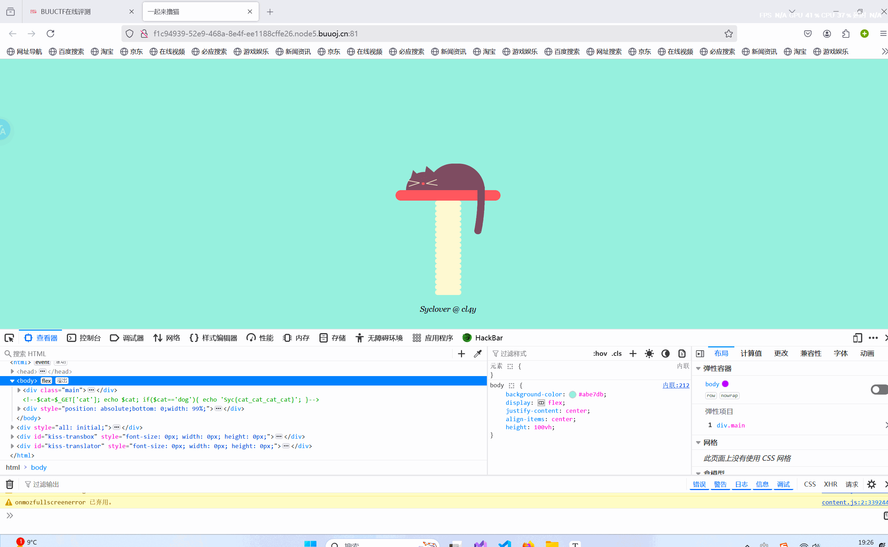
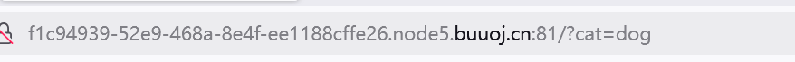
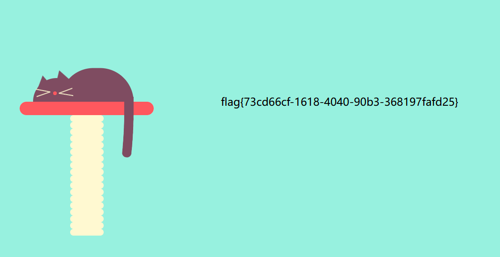

首先查看源码



发现此处有被注释掉的代码

```
<!--
        $cat=$_GET['cat'];
        echo $cat;
        if($cat=='dog'){
            echo 'Syc{cat_cat_cat_cat}';
        }
        -->
```

然后构造payload

Payload：中文 ’ 有效载荷 '，指成功exploit之后，攻击代码释放的具有攻击能力的能够实现攻击者目的的代码。

```
/?cat=dog
```

##### 直接在网页地址栏中构造payload



这样就能得到flag了


