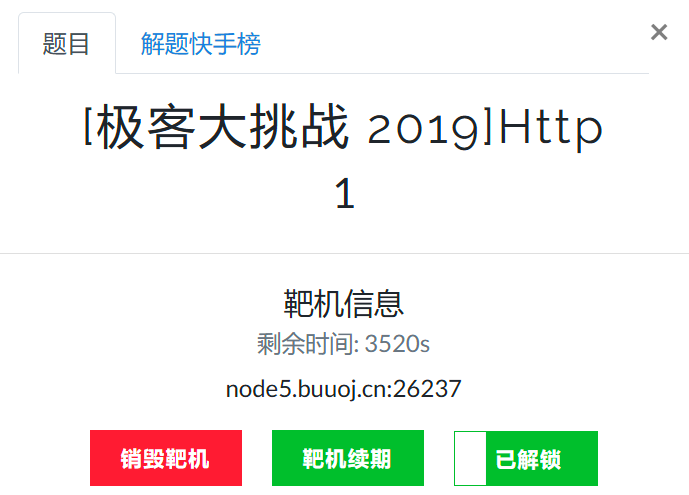
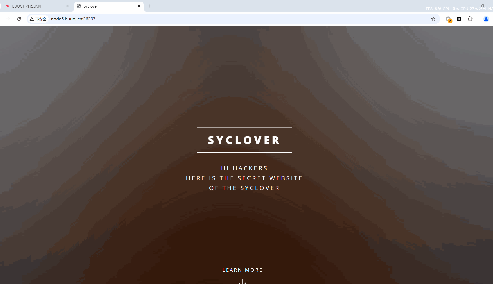
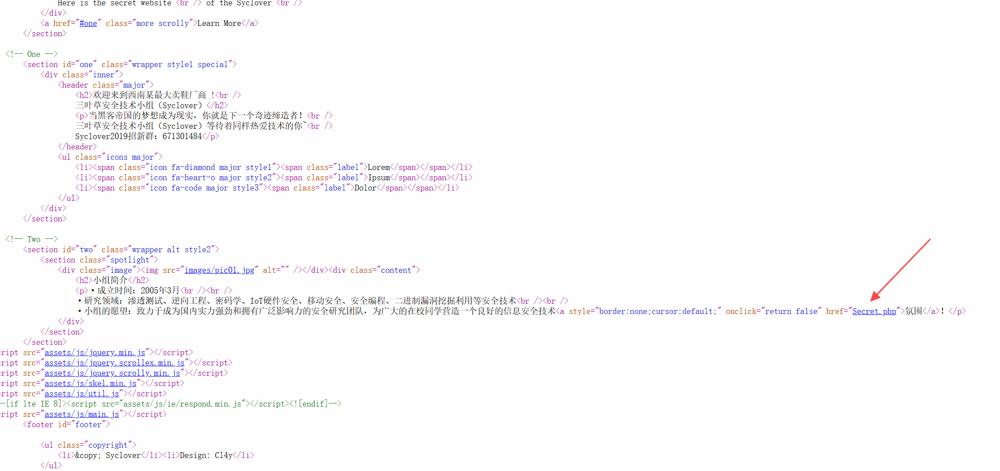
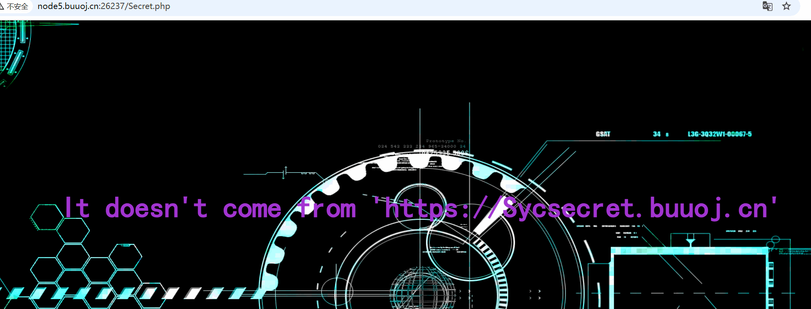
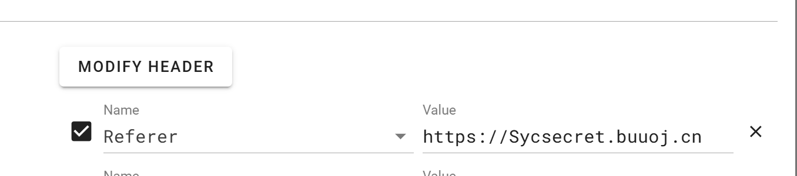

首先打开靶机，发现一个链接



进入发现是一个招新页面



查看源代码发现一个隐藏的超链接指向secret.php



点开发现显示我们不是从https://Sycsecret.buuoj.cn跳转过来的



这时候就想到referer头的作用

```
Referer头在HTTP请求中主要用于指示当前请求的来源页面，帮助服务器了解用户是从哪个页面跳转而来的‌
```

使用hackbar修改Referer头,用burpsuite也可



修改完成后又显示请使用"Syclover" 浏览器


这时就想到user-agent的作用

```
User-Agent（用户代理）在HTTP请求中起着重要作用，主要用于标识发送请求的客户端信息，包括网络、浏览器类型、版本号等‌。具体来说，User-Agent的作用包括以下几个方面：‌12
```

使用hackbar修改user-agent


重新打开网页又显示只能在本地阅读


这时就想到x-forwarded-for

```
X-Forwarded-For（XFF）的作用主要是帮助服务器获取通过HTTP代理或负载均衡方式连接到Web服务器的客户端的原始IP地址
```

使用hackbar修改X-Forwarded-For为127.0.0.1或者localhost


得到flag


